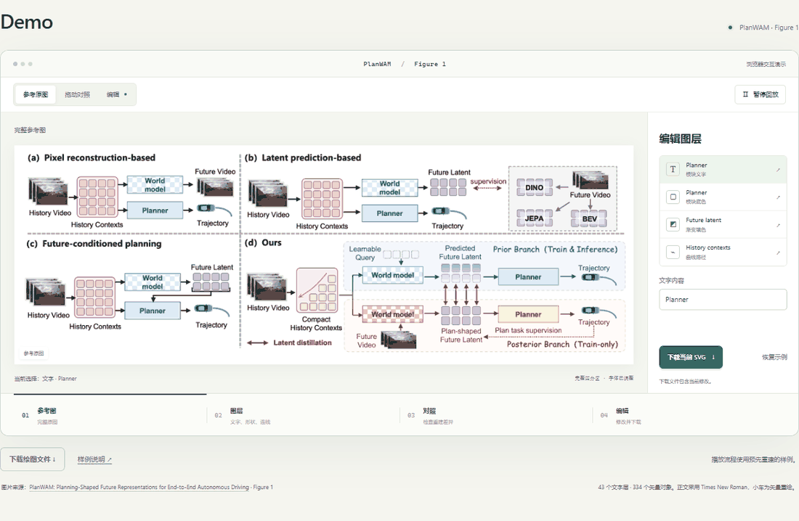

# Paper Figure to Figma

Reconstruct research figures as editable Figma text, shapes, arrows and vector icons. Export SVG or PDF.

[中文](README.zh-CN.md) · [Quick Start](START_HERE.md) · [Demo](#demo)

## Quick Start

[Download ZIP](https://github.com/sidiangongyuan/paper-figure-to-figma/archive/refs/heads/main.zip) and unzip it. The plugin and demo are ready to use.

### Web model + Figma plugin

Requires Figma Desktop and a web model that accepts images and returns text or files.

1. In a Figma Design file, open **Plugins → Development → Import plugin from manifest…** and select `figma-plugin/manifest.json`.
2. Run **Paper Figure to Figma (local)**. Click **加载 PlanWAM 示例 → 生成到 Figma** to try the included figure.
3. For your own figure, select the full reference image in the plugin. Copy the drawing instructions and send them with the image to your web model.
4. Import the returned `.json` file, compare the result, then export SVG or PDF.

[Installation and usage](docs/WEB_QUICKSTART.md)

### Codex

1. Open the unzipped repository folder in Codex and start a new chat.
2. Attach the full reference image and send:

```text
Use $paper-figure-to-figma to reconstruct this full figure,
review the rendered result, and export the editable artwork.
```

The skill uses connected Figma tools automatically. Connect your Figma account when prompted; include a Design link to edit an existing file.

[Codex setup](docs/CODEX_QUICKSTART.md)

### Prompt

Open [web/index.html](web/index.html), choose a template and add your preferences. Copy the prompt and send it with the full reference image to Codex. [Usage and GitHub Pages](docs/PROMPT_PAGE.md).

## Demo

Open **`demo/index.html`** in a browser. Compare the reference, edit text, fills and curves, and download the edited SVG. The demo works offline.



[Reference](examples/planwam/reference.png) · [Editable SVG](examples/planwam/reconstruction.svg) · [Project file](examples/planwam/planwam.scene.json) · [Example notes](examples/planwam/README.md)

Figure source: **[PlanWAM: Planning-Shaped Future Representations for End-to-End Autonomous Driving](https://arxiv.org/abs/2610.11382)**, Xu et al., 2026, Figure 1. The reconstruction uses Times New Roman body text and redrawn vector car icons. Original material belongs to its authors.

## Documentation

[Quick Start](START_HERE.md) · [Demo controls](docs/SHOWCASE.md) · [Development](docs/DEVELOPMENT.md)

Workflow reference: [Image To Slice](https://github.com/50kg/image-to-slice). Code license: pending.
