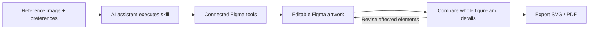
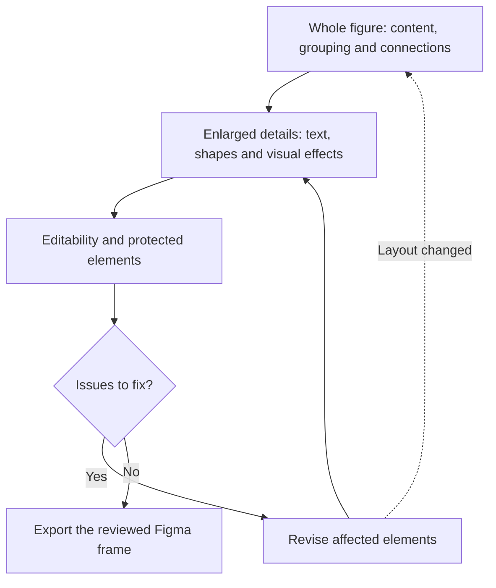

# Paper Figure to Figma

**Rebuild research figures with high fidelity. Keep every step editable.**

**What you need:** An AI assistant with image understanding, skill support and tool execution, plus an authorized Figma connection with write access.

**What you get:** High-quality, editable research vector artwork with SVG and PDF export.

[中文](README.zh-CN.md) · [Quick Start](#quick-start) · [Workflow](#workflow) · [Examples](#examples) · [TODO](#todo) · [Prompt builder](https://sidiangongyuan.github.io/paper-figure-to-figma/)

[](examples/agentthink/reconstruction.svg)

AgentThink: **59 editable text layers**, **264 vector path nodes**, **0 bitmap fills**. [Open SVG](examples/agentthink/reconstruction.svg) · [Project file](examples/agentthink/agentthink.scene.json) · [Source and reconstruction notes](examples/agentthink/README.md)

**v0.1.0 · Preview**

## Quick Start

1. [Download ZIP](https://github.com/sidiangongyuan/paper-figure-to-figma/archive/refs/heads/main.zip), unzip it and open the repository in a skill-capable AI assistant.
2. Ask the assistant to read `.agents/skills/paper-figure-to-figma/SKILL.md`, or run `python tools/install_skill.py` to install in your personal Codex skill directory.
3. Authorize the assistant's Figma connection, attach the full reference image and provide a target Figma Design link.

```text
Use $paper-figure-to-figma to reconstruct this image in the linked Figma canvas,
review the whole figure and details, then export editable SVG and PDF.
```

The skill discovers and calls connected Figma tools. The host needs image input, local skill/script execution and external tool support. [Installation and connection](docs/CODEX_QUICKSTART.md)

Use the [prompt builder](https://sidiangongyuan.github.io/paper-figure-to-figma/) for font, color and editing preferences.

## Workflow

Start with a complete reference image and any font, layout or editing preferences. You can use this workflow without an original generation prompt or VLM API key.



The skill coordinates image interpretation, scene authoring, native layers, comparison and revision. The Figma connection supplies write access. A chat-only interface needs a host with these execution capabilities to complete the canvas work. [Usage guide](docs/CODEX_QUICKSTART.md)

### Compare whole figure and details

Review uses the reference image, the current Figma export and the requested changes. Compare matching regions at comparable scales, treating requested typography or layout changes as part of the target.



| Review | What to check | Result |
| --- | --- | --- |
| Whole figure | Missing content, panel arrangement, relative sizes, grouping and cross-panel arrow endpoints | Locate structural differences |
| Enlarged details | Text accuracy and fit, spacing, curves, gradients, backings, repeated elements and layer order | Identify the region, observed difference and correction |
| Editability | Editable text, independent vector elements, useful groups and user-protected content | Confirm the result can be revised without disturbing protected elements |

Fix content and connection errors first, then readability, then appearance. After each correction, inspect the affected region and protected elements; revisit the whole figure when layout changes. End the review when these checks pass, with approximations and uncertainties documented. Unconfirmed scientific text or connections remain pending, and node counts alone do not establish fidelity. Check publication-size readability separately when the final dimensions are known.

## Examples

### AgentThink

The complete data generation, two-stage training, inference and evaluation workflow. Complex small illustrations and brand symbols are approximate vector redraws; some placeholder strings in the source's small cards are unreadable.


[Reference](examples/agentthink/reference.png) · [Editable SVG](examples/agentthink/reconstruction.svg) · [Project file](examples/agentthink/agentthink.scene.json) · [Paper](https://arxiv.org/abs/2505.15298) · [Example notes](examples/agentthink/README.md)

### PlanWAM

[](examples/planwam/reconstruction.svg)

PlanWAM: **43 editable text layers**, **334 vector objects**, **8 gradients**. Input/output RGB crops remain separate image layers. [Open SVG](examples/planwam/reconstruction.svg) · [Project file](examples/planwam/planwam.scene.json)

Curves, gradients and local text backings are shown at a closer scale below. Body text uses Times New Roman; the car icons are approximate vector redraws.


[Reference](examples/planwam/reference.png) · [Editable SVG](examples/planwam/reconstruction.svg) · [Project file](examples/planwam/planwam.scene.json) · [Example notes](examples/planwam/README.md)

Source: [PlanWAM: Planning-Shaped Future Representations for End-to-End Autonomous Driving](https://arxiv.org/abs/2610.11382), Figure 1. Original content belongs to its authors. Check readability at the intended paper size.

## Demo

Open **`demo/index.html`** after downloading the repository. Drag the comparison divider, edit text, fills and curves, and download the edited SVG. The demo works offline.


This 13-second loop shows the included browser demo, with pauses at the start and finish. [Demo controls](docs/SHOWCASE.md)

## TODO

Completed features and possible next improvements; unchecked items are planned work.

- [x] ~~Codex skill with connected Figma drawing, review and export~~
- [x] ~~PlanWAM and AgentThink examples with editable files and visual comparisons~~
- [x] ~~Prompt builder and a slower workflow demonstration~~
- [ ] Add checks for font size, line width and spacing at the final paper dimensions.
- [ ] Improve selective updates and preservation of manual Figma edits.
- [ ] Improve mathematical notation and formula reconstruction.
- [ ] Add style transfer for colors, typography and visual appearance while preserving content and structure.
- [ ] Support editable import/export with PowerPoint, draw.io and other drawing tools.
- [ ] Expand the example set and publish reproducible fidelity evaluations.
- [ ] Expand compatibility testing across skill-capable assistants and operating systems.

## Documentation

[Quick Start](START_HERE.md) · [Demo controls](docs/SHOWCASE.md) · [Development](docs/DEVELOPMENT.md)

Workflow reference: [Image To Slice](https://github.com/50kg/image-to-slice).

## License

Project code is licensed under [MIT](LICENSE). Reference figures, paper content and figure-derived example assets retain their original rights and applicable terms; see the source attribution in each example.
