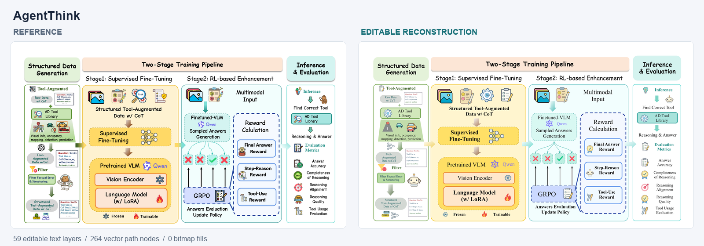
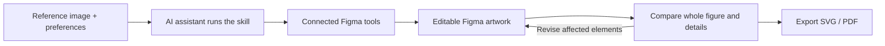
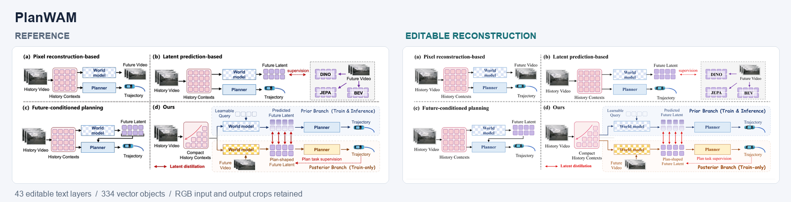
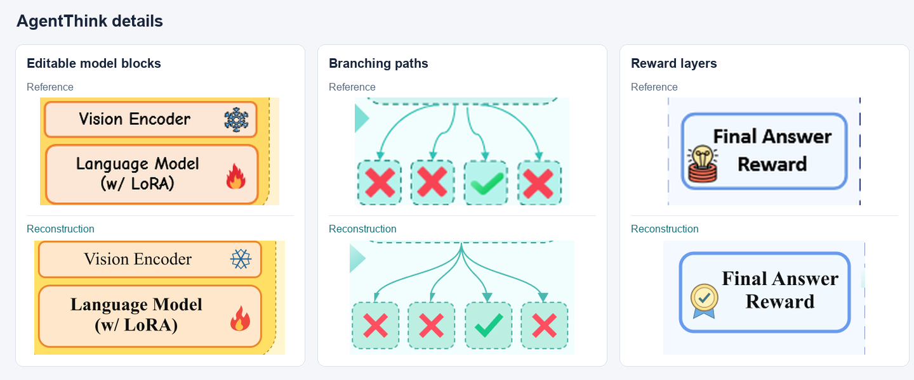
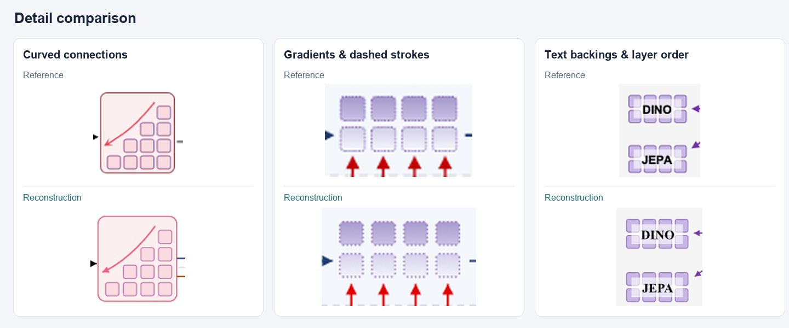

<div align="center">

<a href="https://github.com/sidiangongyuan/paper-figure-to-figma">
  
</a>

### Rebuild research figures with high fidelity. Keep every step editable.

[](LICENSE)
[](#-roadmap)
[](https://github.com/sidiangongyuan/paper-figure-to-figma/stargazers)
[](.agents/skills/paper-figure-to-figma/SKILL.md)
[](https://www.figma.com/)
[](docs/DEVELOPMENT.md)

[](https://sidiangongyuan.github.io/paper-figure-to-figma/)
[](#-demo)

**English** · [简体中文](README.zh-CN.md)

[Quick Start](#-quick-start) • [How it works](#-how-it-works) • [Examples](#-examples) • [Demo](#-demo) • [FAQ](#-faq)

<br>

<a href="examples/agentthink/reconstruction.svg"></a>

<sub>Left: reference figure · Right: native Figma reconstruction · <a href="examples/agentthink/reconstruction.svg">Open SVG</a> · <a href="examples/agentthink/README.md">Example notes</a></sub>

</div>

<br>

**Paper Figure to Figma** is an agent skill that turns an image of a research figure into native, editable Figma artwork. Give your AI assistant the figure and a Figma file: it redraws every label, shape and connection as real layers, compares the result with the reference at whole-figure and detail level, fixes what differs, and exports SVG and PDF.

It is built for the moment when all you have is the image — a lost source file, a figure from a paper, or a draft from an image generator — and you still need to edit it.

## ✨ Features

- **Native, editable layers** — labels stay text, shapes and arrows stay vectors. Only input/output photos are kept as image layers.
- **Details that usually get lost** — gradients, local text backings, transparency, dashed strokes, Bézier curves and stacking order.
- **Built-in review loop** — checks the whole figure, then enlarged details and editability, and revises only the affected elements.
- **Revise without starting over** — follow-up requests update the existing Figma frame and leave the elements you protect untouched.
- **Paper-ready typography** — Times New Roman body text and a clear size hierarchy by default; override any of it.
- **No extra API key** — runs inside your assistant with its Figma connection. No VLM API key or original generation prompt needed.
- **Portable output** — editable SVG, PDF and a reusable `.scene.json` project file.

## 🚀 Quick Start

**Requirements**

- An AI assistant that can view images, load local skills, run scripts and call external tools (verified with Codex).
- A Figma connection in that assistant with edit access to the target Design file.
- Python 3.10+. Pillow is needed only when the figure contains photo crops.

**1. Install the skill**

```bash
git clone https://github.com/sidiangongyuan/paper-figure-to-figma.git
cd paper-figure-to-figma
python tools/install_skill.py
```

This installs to `$CODEX_HOME/skills/paper-figure-to-figma` (default `~/.codex/skills/paper-figure-to-figma`). Use `--update` to upgrade an existing install, or `--dest <skills-dir>/paper-figure-to-figma` for another assistant. To skip installation, open the repository in your assistant and ask it to read `.agents/skills/paper-figure-to-figma/SKILL.md`.

**2. Connect Figma**

Enable the Figma tool connection in your assistant and authorize your account.

**3. Rebuild a figure**

Attach the complete reference image and send:

```text
Use $paper-figure-to-figma to reconstruct this image in the linked Figma canvas,
review the whole figure and details, then export editable SVG and PDF.
Figma: <your Design file link>
```

Need specific fonts, colors or edits? Compose the request with the [Prompt Builder](https://sidiangongyuan.github.io/paper-figure-to-figma/).

Full installation and connection guide: [docs/CODEX_QUICKSTART.md](docs/CODEX_QUICKSTART.md)

## 🔄 How it works



The skill reads the figure, writes a scene description, draws it as native Figma layers, then reviews real Figma exports against the reference. Content and connection errors are fixed first, then readability, then appearance.

<details>
<summary><b>What the review checks</b></summary>

<br>

| Review | What to check | Result |
| --- | --- | --- |
| Whole figure | Missing content, panel arrangement, relative sizes, grouping and cross-panel arrow endpoints | Structural differences located |
| Enlarged details | Text accuracy and fit, spacing, curves, gradients, backings, repeated elements and layer order | Region, observed difference and correction |
| Editability | Editable text, independent vector elements, useful groups and protected content | Result can be revised without disturbing protected elements |

Full instructions: [prompts/02-review.md](prompts/02-review.md)

</details>

## 🎨 Examples

<table>
  <tr>
    <th width="50%">AgentThink</th>
    <th width="50%">PlanWAM</th>
  </tr>
  <tr>
    <td><a href="examples/agentthink/README.md"></a></td>
    <td><a href="examples/planwam/README.md"></a></td>
  </tr>
  <tr>
    <td>Data generation, two-stage training, inference and evaluation pipeline.<br><b>59</b> text layers · <b>264</b> vector path nodes · <b>0</b> bitmap fills</td>
    <td>Four-panel comparison of world-model planning approaches.<br><b>43</b> text layers · <b>334</b> vector objects · <b>8</b> gradients</td>
  </tr>
  <tr>
    <td><a href="https://arxiv.org/abs/2505.15298">Paper</a> · <a href="examples/agentthink/reference.png">Reference</a> · <a href="examples/agentthink/reconstruction.svg">SVG</a> · <a href="examples/agentthink/agentthink.scene.json">Scene</a></td>
    <td><a href="https://arxiv.org/abs/2610.11382">Paper</a> · <a href="examples/planwam/reference.png">Reference</a> · <a href="examples/planwam/reconstruction.svg">SVG</a> · <a href="examples/planwam/planwam.scene.json">Scene</a></td>
  </tr>
</table>

<details>
<summary><b>Detail comparisons</b></summary>

<br>

**AgentThink** — model blocks, curved branches and reward layers



**PlanWAM** — curved connections, gradients and text backings



</details>

Reference figures belong to their original authors; see each example's notes for sources and approximations.

## 🎮 Demo

Download the repository and open **`demo/index.html`** in a browser — no install, works offline. Drag the divider to compare the reference with the reconstruction, edit text, fills and curves, then download the edited SVG.


The demo uses a pre-built PlanWAM reconstruction to show the editable result; it does not run the AI reconstruction. [Demo controls](docs/SHOWCASE.md)

## 🧭 Roadmap

- [x] Agent skill with connected Figma drawing, review and export
- [x] PlanWAM and AgentThink examples with editable files and visual comparisons
- [x] Prompt Builder and offline demo
- [ ] Check font size, line width and spacing at the final paper dimensions
- [ ] Better selective updates that preserve manual Figma edits
- [ ] Better mathematical notation and formula reconstruction
- [ ] Style transfer for colors, typography and appearance while keeping content and structure
- [ ] Editable import/export with PowerPoint, draw.io and other drawing tools
- [ ] More examples and reproducible fidelity evaluations
- [ ] Compatibility testing across more assistants and operating systems

## 🚧 Limitations

- **Not pixel-identical.** Fidelity is judged through the whole-figure and detail review, not a universal accuracy score.
- **Small illustrations are approximations.** Complex icons, logos and tiny drawings are vector redraws; unreadable source text is flagged rather than guessed.
- **Photo crops follow the reference resolution.** Use original dataset images for final layouts when available.
- **Full reimports can overwrite manual edits** to managed layers. Duplicate hand-edited artwork before a full rebuild.
- **Verified with Codex** and its Figma connection; other assistants and operating systems are not yet fully tested.
- **Check readability at the final paper size** once the physical dimensions are known.

## ❓ FAQ

<details>
<summary><b>Do I need an API key or the original generation prompt?</b></summary>

No. The skill runs inside your AI assistant and works from the image alone.

</details>

<details>
<summary><b>Which AI assistants are supported?</b></summary>

It is verified with Codex. Other assistants need image input, local skill and script execution, and external tool calls; install with `--dest` pointing to their skill directory.

</details>

<details>
<summary><b>Do I need a Figma plugin?</b></summary>

No custom plugin is required. The skill uses the Figma tools connected to your assistant and needs edit access to the target Design file.

</details>

<details>
<summary><b>What happens if Figma is not connected?</b></summary>

The skill prepares the scene file and SVG locally, tells you which step is missing — no connection, expired authorization, read-only access or no file access — and continues writing to Figma once it is fixed.

</details>

<details>
<summary><b>Can I keep editing after the first version?</b></summary>

Yes. Edit directly in Figma, or send the assistant the same Figma link with your changes and list the elements that must stay unchanged.

</details>

## 🤝 Contributing

Issues, ideas and new examples are welcome.

- **Bug or unexpected result** — open an issue with the reference image (if shareable), your request and the assistant you used.
- **New example** — include the source paper, a reference image you may redistribute, the `.scene.json` and the exported SVG.
- **Code changes** — run the checks in [docs/DEVELOPMENT.md](docs/DEVELOPMENT.md) before opening a pull request.

## 🙏 Acknowledgements

The workflow draws on [Image To Slice](https://github.com/50kg/image-to-slice). Example figures come from [AgentThink](https://github.com/curryqka/AgentThink) and [PlanWAM](https://jinchan9.github.io/PlanWAM_project_page/).

## 📄 License

Code is released under the [MIT License](LICENSE). Reference figures, paper content and figure-derived example assets retain their original rights; see the source attribution in each example.
