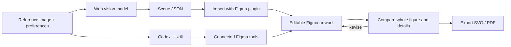

# Paper Figure to Figma

Reconstruct research figures as editable Figma text, shapes, arrows and vector icons. Export SVG or PDF.

[中文](README.zh-CN.md) · [Quick Start](#quick-start) · [Workflow](#workflow) · [Examples](#examples) · [TODO](#todo) · [Prompt builder](https://sidiangongyuan.github.io/paper-figure-to-figma/)

[](examples/agentthink/reconstruction.svg)

AgentThink: **59 editable text layers**, **264 vector path nodes**, **0 bitmap fills**. [Open SVG](examples/agentthink/reconstruction.svg) · [Project file](examples/agentthink/agentthink.scene.json) · [Source and reconstruction notes](examples/agentthink/README.md)

## Quick Start

[Download ZIP](https://github.com/sidiangongyuan/paper-figure-to-figma/archive/refs/heads/main.zip) and unzip it. The plugin and demo are ready to use.

### Web model + Figma plugin

Requires Figma Desktop and a web model that accepts images and returns text or files.

1. In a Figma Design file, open **Plugins → Development → Import plugin from manifest…** and select `figma-plugin/manifest.json`.
2. Run **Paper Figure to Figma (local)**. Click **加载 PlanWAM 示例 → 生成到 Figma** to try the included figure.
3. For your own figure, select the full reference image in the plugin. Copy the drawing instructions and send them with the image to your web model.
4. Import the returned `.json` file, compare the result, then export SVG or PDF.

[Installation and usage](docs/WEB_QUICKSTART.md)

### Codex

1. Open the unzipped repository folder in Codex and start a new chat.
2. Attach the full reference image and send:

```text
Use $paper-figure-to-figma to reconstruct this full figure,
review the rendered result, and export the editable artwork.
```

The skill uses connected Figma tools automatically. Connect your Figma account when prompted; include a Design link to edit an existing file.

[Codex setup](docs/CODEX_QUICKSTART.md)

### Prompt

Open [web/index.html](web/index.html), choose a template and add your preferences. Copy the prompt and send it with the full reference image to Codex. [Usage and GitHub Pages](docs/PROMPT_PAGE.md).

## Workflow

Start with a complete reference image and any font, layout or editing preferences. You can use this workflow without an original generation prompt or VLM API key.



The model interprets the image and produces the drawing instructions. The web path uses manual file transfer; the Codex path can write to Figma through the connected tools. Both paths preserve editable text and vector elements, then review layout, typography, gradients, curves and layer order against the reference. Check readability at the intended paper size before publication.

[Web workflow](docs/WEB_QUICKSTART.md) · [Codex workflow](docs/CODEX_QUICKSTART.md)

## Examples

### AgentThink

The complete data generation, two-stage training, inference and evaluation workflow. Complex small illustrations and brand symbols are approximate vector redraws; some placeholder strings in the source's small cards are unreadable.


[Reference](examples/agentthink/reference.png) · [Editable SVG](examples/agentthink/reconstruction.svg) · [Project file](examples/agentthink/agentthink.scene.json) · [Paper](https://arxiv.org/abs/2505.15298) · [Example notes](examples/agentthink/README.md)

### PlanWAM

[](examples/planwam/reconstruction.svg)

PlanWAM: **43 editable text layers**, **334 vector objects**, **8 gradients**. Input/output RGB crops remain separate image layers. [Open SVG](examples/planwam/reconstruction.svg) · [Project file](examples/planwam/planwam.scene.json)

Curves, gradients and local text backings are shown at a closer scale below. Body text uses Times New Roman; the car icons are approximate vector redraws.


[Reference](examples/planwam/reference.png) · [Editable SVG](examples/planwam/reconstruction.svg) · [Project file](examples/planwam/planwam.scene.json) · [Example notes](examples/planwam/README.md)

Source: [PlanWAM: Planning-Shaped Future Representations for End-to-End Autonomous Driving](https://arxiv.org/abs/2610.11382), Figure 1. Original content belongs to its authors. Check readability at the intended paper size.

## Demo

Open **`demo/index.html`** after downloading the repository. Drag the comparison divider, edit text, fills and curves, and download the edited SVG. The demo works offline.


This 13-second loop shows the included browser demo, with pauses at the start and finish. [Demo controls](docs/SHOWCASE.md)

## TODO

Completed features and possible next improvements; unchecked items are planned work.

- [x] ~~Web-model prompts and a local Figma import plugin~~
- [x] ~~Codex skill with connected Figma drawing, review and export~~
- [x] ~~PlanWAM and AgentThink examples with editable files and visual comparisons~~
- [x] ~~Prompt builder and a slower workflow demonstration~~
- [ ] Add checks for font size, line width and spacing at the final paper dimensions.
- [ ] Improve selective updates and preservation of manual Figma edits.
- [ ] Improve mathematical notation and formula reconstruction.
- [ ] Add style transfer for colors, typography and visual appearance while preserving content and structure.
- [ ] Support editable import/export with PowerPoint, draw.io and other drawing tools.
- [ ] Expand the example set and publish reproducible fidelity evaluations.
- [ ] Complete end-to-end testing of plugin installation and import/export in Figma Desktop.

## Documentation

[Quick Start](START_HERE.md) · [Demo controls](docs/SHOWCASE.md) · [Development](docs/DEVELOPMENT.md)

Workflow reference: [Image To Slice](https://github.com/50kg/image-to-slice).

## License

Project code is licensed under [MIT](LICENSE). Reference figures, paper content and figure-derived example assets retain their original rights and applicable terms; see the source attribution in each example.
