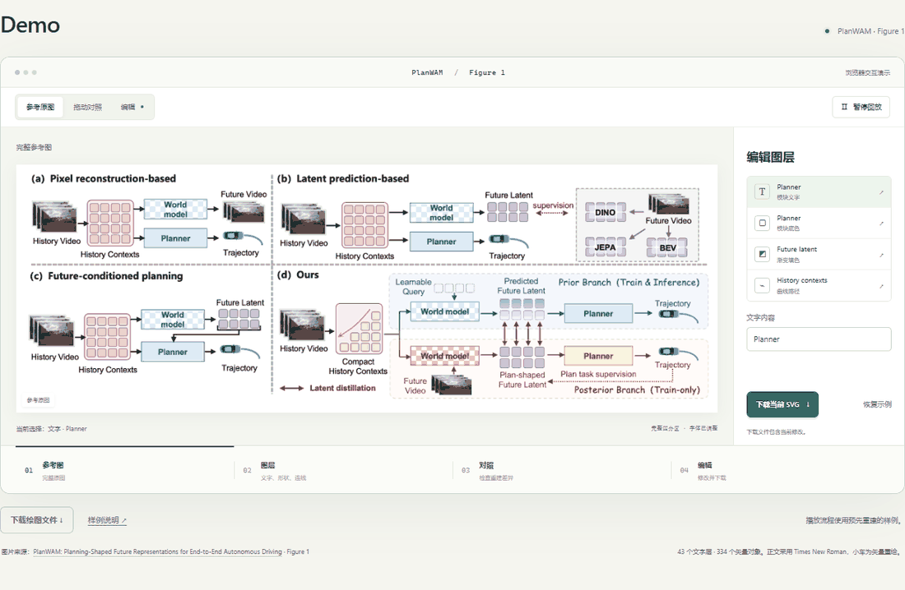
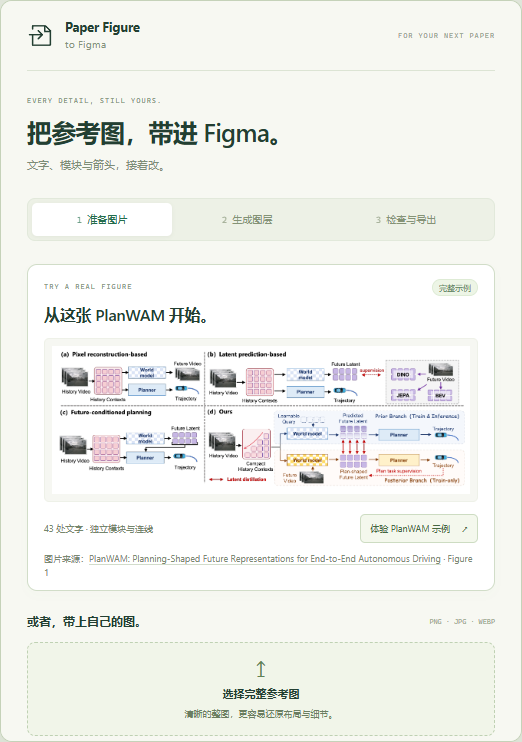

**从一张参考图，到每个可编辑的细节。**

把科研图带进 Figma，改文字、调配色、挪模块。 
带上完整参考图，沿用你熟悉的看图模型。

[English](README.md) · [立即上手](START_HERE.md) · [完整示例](examples/planwam/) · [操作演示](docs/SHOWCASE.md)

**亲手试一试：** [下载 ZIP](https://github.com/sidiangongyuan/paper-figure-to-figma/archive/refs/heads/main.zip)，解压后双击 **`demo/index.html`**。演示可离线打开，支持改文字、调配色、修改渐变与曲线，并下载修改后的 SVG 和项目文件。

图片来源：**[PlanWAM: Planning-Shaped Future Representations for End-to-End Autonomous Driving](https://arxiv.org/abs/2610.11382)**，Xu et al., 2026，Figure 1。演示使用本轮已经完成的整图重建与实际 Figma 导出，正文调整为 Times New Roman，小车图标采用矢量重绘。[查看样例说明](examples/planwam/README.md)。

## 下一次改图，轻一点

- **文字直接改。** 保留内容、字体与字号，方便统一全篇风格。
- **模块分别调。** 框、连线、箭头和矢量图标可独立处理。
- **细节留在图层里。** 渐变、浅色打底、曲线与虚线都有对应对象。
- **带进论文排版。** 在 Figma 中继续编辑，导出 SVG 或 PDF。

PlanWAM 样例包含 **43个可编辑文字层、334个矢量对象和完整四分区**。RGB 输入与输出保留为独立图片层。绘图文件和可编辑 SVG 随仓库提供。

## 开始第一张图

| 使用方式 | 操作 |
| --- | --- |
| 网页模型 | 安装附带的 Figma 插件 → 选择整图并复制指令 → 将模型返回的文件导入 → 对照修订并导出 |
| Codex | 打开仓库 → 上传整图 → 调用 `$paper-figure-to-figma` → 自动使用已连接的 Figma 工具完成绘制与复核 |

第一次可以在插件中点 **体验 PlanWAM 示例 → 生成到 Figma**。完整绘图文件已经准备好，可以直接检查文字和图形的编辑效果。

**[跟着上手教程开始 →](START_HERE.md)**

## 准备什么

一张清晰的完整参考图、一个支持看图的模型账号，以及 Figma。原始 RGB、SVG 图标和准确文字清单可以作为补充。网页路线无需 API Key 或编译工具；本地开发插件在 Figma 桌面版中安装。

正文默认 Times New Roman，编辑字号至少16px。放进论文后，按最终尺寸检查实际字号与线宽。重建结果需要整图和局部对照，图标近似等差异记录在样例说明中。

## 更多

[网页教程](docs/WEB_QUICKSTART.md) · [Codex 教程](docs/CODEX_QUICKSTART.md) · [演示说明](docs/SHOWCASE.md) · [开发文档](docs/DEVELOPMENT.md) · [验证记录](docs/entrypoint-validation.md)

当前提供预览版。实际 Figma 绘制、导出与浏览器交互已验证；本地插件首次安装仍需在 Figma 桌面版中完成检查。Community 分发留待后续安排。

图片及论文内容归 PlanWAM 作者所有。工作流参考 [Image To Slice](https://github.com/50kg/image-to-slice)，展示方式参考 [AI Job Search](https://github.com/MadsLorentzen/ai-job-search) 与 [OpenCode](https://github.com/anomalyco/opencode)。本项目代码的分发许可待确定。
