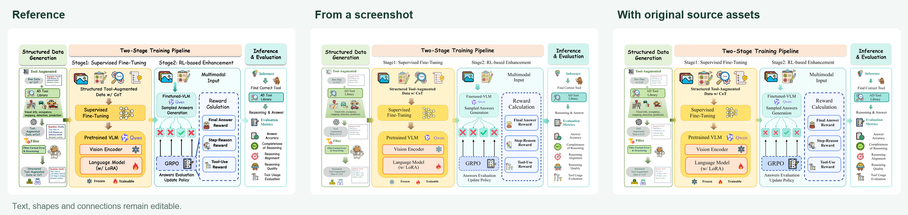
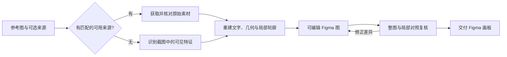
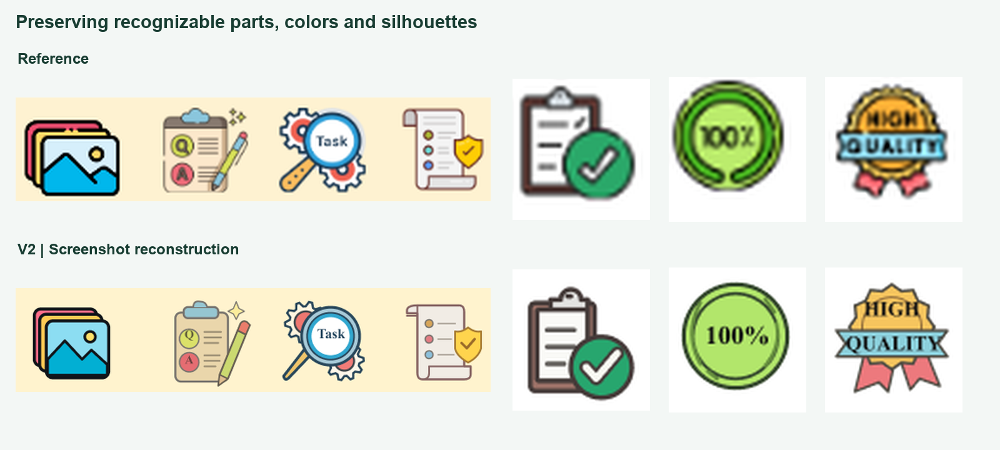
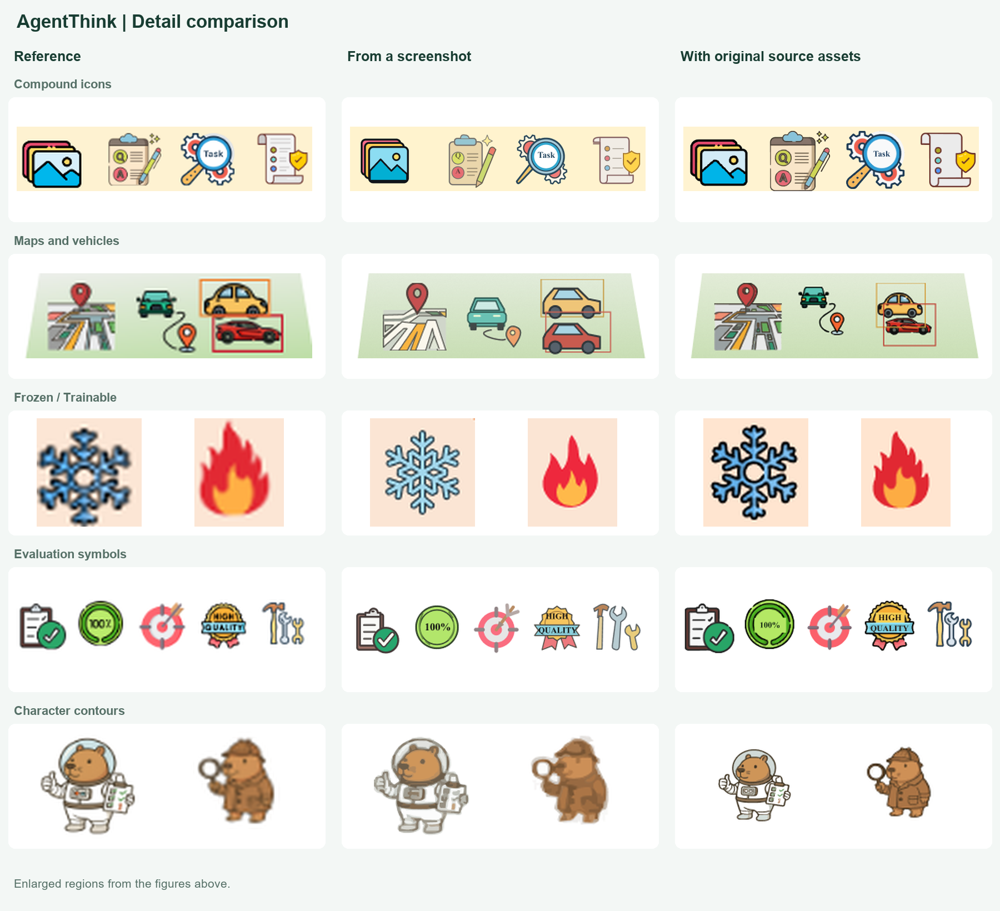
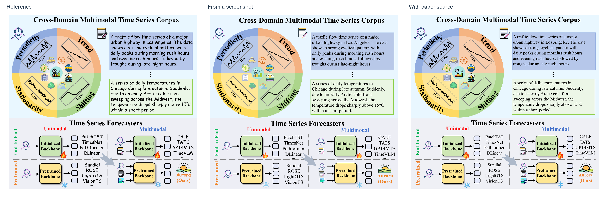
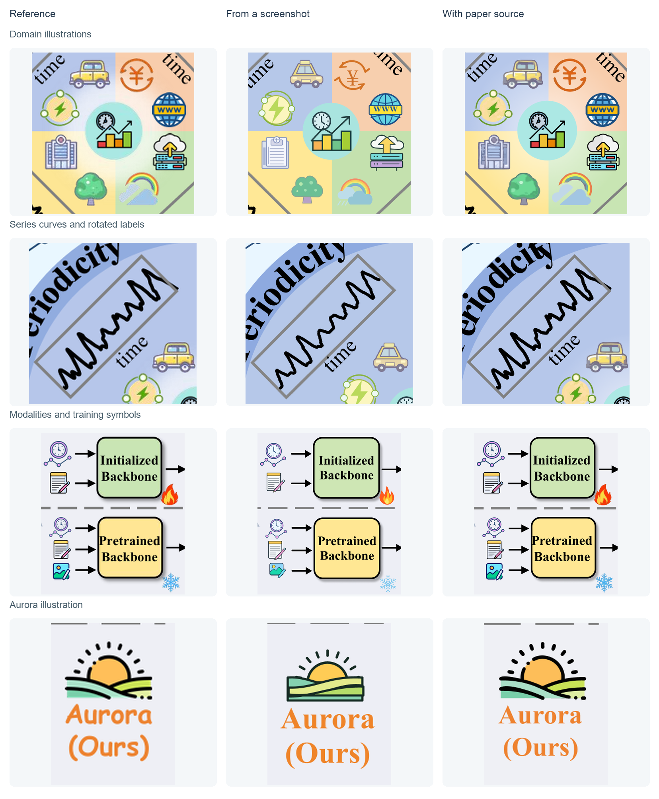

<div align="center">

<a href="https://github.com/sidiangongyuan/paper-figure-to-figma">
  
</a>

### 高保真重建科研图，自由编辑每一步。

[](LICENSE)
[](CHANGELOG.md)
[](https://github.com/sidiangongyuan/paper-figure-to-figma/stargazers)
[](.agents/skills/paper-figure-to-figma/SKILL.md)
[](https://www.figma.com/)
[](docs/DEVELOPMENT.md)

[](https://sidiangongyuan.github.io/paper-figure-to-figma/)
[](#-demo)

[English](README.md) · **简体中文**

[快速开始](#-快速开始) • [工作原理](#-工作原理) • [案例](#-案例) • [Demo](#-demo) • [最近更新](#最近更新) • [常见问题](#-常见问题)

<br>

<a href="examples/agentthink/README.md"></a>

<sub>原图 · 截图重建 · 有来源重建 · <a href="examples/agentthink/README.md">案例与文件</a> · <a href="assets/agentthink-reconstruction-details.png">放大细节</a></sub>

</div>

<br>

**Paper Figure to Figma** 是一个 Agent Skill，把科研图的图片重建为原生、可编辑的 Figma 图。把图片和 Figma 文件交给 AI 助手，它会把每个标签、形状和连接线绘制成真实图层，在整图与局部两个层面与参考图对照，修正差异，默认交付可编辑 Figma 画板；需要文件时再导出。

提供截图即可开始，也可以补充论文链接、PDF 或原始素材来源。助手会自行获取可访问且与参考图匹配的素材；没有可用来源时，继续按截图重建。

## 最近更新

**0.2.0 · 2026 年 11 月 4 日** — [完整更新日志](CHANGELOG.md)

- **新增可选来源获取**：提供论文链接、PDF 或项目来源，即可获取并核对匹配的原始素材。
- **改进截图重建**：保留复合图标的外形与配色，修复描摹碎边，并覆盖整张图逐区检查。
- **更新效果展示**：AgentThink 与 Aurora 重建，展示两种输入条件下的整图与放大细节对比。[Aurora 案例](examples/aurora/README.md)
- **交付方式调整**：默认提供可编辑 Figma 画板，需要 SVG/PDF 时再提出导出要求。

已有安装可在仓库目录运行：

```bash
git pull --ff-only
python tools/install_skill.py --update
```

旧安装会自动备份。通过 ZIP 安装的用户，可下载新版仓库后运行同一安装命令，并加上 `--update`。

## ✨ 特性

- **原生可编辑图层**：文字保持为文字，形状和箭头保持为矢量；只有输入、输出照片保留为图片层。
- **还原容易丢失的细节**：渐变、局部文字底板、透明度、虚线、贝塞尔曲线和图层叠放顺序。
- **内置复核闭环**：先查整图，再查局部细节和可编辑性，只修正受影响的元素。
- **修改无需从头再来**：后续修改直接更新已有 Figma 画板，指定保持不变的元素不受影响。
- **论文级排版默认值**：正文默认 Times New Roman，并设置清晰的字号层级；均可按需覆盖。
- **无需额外 API Key**：在 AI 助手及其 Figma 连接中运行，不需要 VLM API Key 或原始生图提示词。
- **按需导出**：默认交付 Figma 画板；需要时可导出 SVG、PDF 和可复用的 `.scene.json`。
- **两条重建流程**：有来源时获取、核对并使用原始素材；无来源时完成整张截图的重建。
- **按外观选择方法**：通过匹配的 SVG、几何重建或局部描摹，保留轮廓、配色与可辨认的组成部分。

## 🚀 快速开始

**准备**

- 支持看图、加载本地 Skill、执行脚本和调用外部工具的 AI 助手（已在 Codex 上验证）。
- 助手中已连接 Figma，并对目标 Design 文件有编辑权限。
- Python 3.10+。图片处理、描摹和 PDF 提取按任务使用可选依赖。

**1. 安装 Skill**

```bash
git clone https://github.com/sidiangongyuan/paper-figure-to-figma.git
cd paper-figure-to-figma
python tools/install_skill.py
```

默认安装到 `$CODEX_HOME/skills/paper-figure-to-figma`（未设置时为 `~/.codex/skills/paper-figure-to-figma`）。用 `--update` 更新已有安装；其他助手可用 `--dest <技能目录>/paper-figure-to-figma` 指定位置。不想安装时，在助手中打开仓库并让它读取 `.agents/skills/paper-figure-to-figma/SKILL.md` 即可。

**2. 连接 Figma**

在助手中启用 Figma 工具连接并完成账号授权。

**3. 重建一张图**

上传完整参考图，发送：

```text
使用 $paper-figure-to-figma，将附图重建到以下 Figma 画布，
检查整图与局部细节，修正后给我可编辑画板链接。
Figma：<你的 Design 文件链接>
来源（可选）：<论文链接、PDF 或原始素材位置>
```

需要指定字体、配色或局部修改时，可用 [Prompt 生成页面](https://sidiangongyuan.github.io/paper-figure-to-figma/) 组织指令。

完整安装与连接说明：[docs/CODEX_QUICKSTART.md](docs/CODEX_QUICKSTART.md)

## 🔄 工作原理



**有来源重建**：根据论文、PDF 或项目来源自行获取可访问的素材，确认与参考图匹配，再提取并重建相关对象。提取到的位图仍需进行矢量重建。

**截图重建**：保留能辨认的轮廓、配色和组成关系，规则部分用几何形状重建，不规则轮廓按需描摹，再修复碎边和失真。处理范围覆盖整张图。

来源为可选信息。只有标题时，默认将查找控制在约 90 秒；来源无法访问或不匹配时继续使用截图。两条流程都检查实际 Figma 结果，先核对整图，再放大细节；修正顺序为内容与连接关系、可读性、外观。[完整流程](prompts/04-source-routing.md)

<details>
<summary><b>复核检查什么</b></summary>

<br>

| 检查层次 | 检查内容 | 输出 |
| --- | --- | --- |
| 整图 | 内容遗漏、分区布局、相对尺寸、分组及跨区箭头端点 | 定位结构差异 |
| 局部放大 | 文字准确性与完整显示、间距、曲线、渐变、底板、重复元素和遮挡顺序 | 标明区域、实际差异及修正方式 |
| 可编辑性 | 可编辑文字、独立矢量元素、合理分组及受保护内容 | 确认可继续修改，且不影响受保护元素 |

完整说明：[prompts/02-review.md](prompts/02-review.md)

</details>

## 🎨 案例

### AgentThink

将截图中的文字、模块、图标和连线重建为可编辑图层；提供匹配的论文或原始素材时，还可以利用其中保留的更多细节。



<details>
<summary><b>放大查看两种重建方式的细节</b></summary>



对比覆盖训练素材、地图与车辆、冻结与训练标记、评估图标及角色轮廓。

</details>

[案例文件与来源](examples/agentthink/README.md) · [历史版本对比](examples/agentthink-v2/README.md)

<table>
  <tr>
    <th width="50%">AgentThink</th>
    <th width="50%">PlanWAM</th>
  </tr>
  <tr>
    <td><a href="examples/agentthink/README.md"></a></td>
    <td><a href="examples/planwam/README.md"></a></td>
  </tr>
  <tr>
    <td>数据生成、两阶段训练、推理与评估的完整流程图。<br>文字、图形与连线均可独立编辑</td>
    <td>四联对比的世界模型规划方法示意图。<br><b>43</b> 个文字层 · <b>334</b> 个矢量对象 · <b>8</b> 处渐变</td>
  </tr>
  <tr>
    <td><a href="https://arxiv.org/abs/2505.15298">论文</a> · <a href="examples/agentthink/reference.png">参考图</a> · <a href="examples/agentthink/reconstruction.svg">SVG</a> · <a href="examples/agentthink/agentthink.scene.json">绘图文件</a></td>
    <td><a href="https://arxiv.org/abs/2610.11382">论文</a> · <a href="examples/planwam/reference.png">参考图</a> · <a href="examples/planwam/reconstruction.svg">SVG</a> · <a href="examples/planwam/planwam.scene.json">绘图文件</a></td>
  </tr>
</table>

<details>
<summary><b>局部细节对比</b></summary>

<br>

**AgentThink**：模型模块、曲线分支和奖励层


**PlanWAM**：曲线连接、渐变和文字底板


</details>

### Aurora

同一张时间序列科研图，分别根据截图和匹配的论文 PDF 重建。对照原图，查看弧形文字、序列曲线、领域插画和模态图标的还原效果。



<details>
<summary><b>放大查看 Aurora 细节</b></summary>



</details>

来源：Wu 等，*[Aurora: Towards Universal Generative Multimodal Time Series Forecasting](https://arxiv.org/abs/2509.22295)*，Figure 1，PDF 第 2 页（arXiv v6）。两版均保留可编辑文字和矢量，无图片图层；正文使用新罗马字体。

[案例说明与论文引用](examples/aurora/README.md) · [截图重建结果](examples/aurora/screenshot.png) · [论文来源重建结果](examples/aurora/source-assisted.png)

参考图版权归原作者所有，来源与近似处理见各案例说明。

## 🎮 Demo

下载仓库后用浏览器打开 **`demo/index.html`**，无需安装，可离线使用。拖动分界线对照原图与重建结果，修改文字、填色和曲线，然后下载编辑后的 SVG。


Demo 使用预先重建好的 PlanWAM 样例展示可编辑效果，不执行 AI 重建。[操作说明](docs/SHOWCASE.md)

## 🧭 路线图

- [x] Agent Skill 调用 Figma 完成绘制、复核和导出
- [x] PlanWAM、AgentThink 可编辑案例及可视化对比
- [x] ~~Aurora 截图与有来源重建，配套整图及局部细节对比~~
- [x] Prompt 生成页面与离线 Demo
- [x] ~~来源获取、PDF 图片提取与截图重建流程~~
- [x] ~~AgentThink 完整重建、整图及多区域细节对比~~
- [x] ~~内置彩色与线性 SVG 素材，保留来源记录和许可~~
- [ ] 改善低分辨率角色轮廓、小配件及背景残边的处理
- [ ] 从原始 PDF 提取可复用的矢量与文字对象
- [ ] 按论文最终尺寸检查字号、线宽和间距
- [ ] 完善局部更新，保留用户在 Figma 中的手动修改
- [ ] 改善数学符号与公式的还原
- [ ] 风格迁移：保留内容与结构，调整配色、字体和视觉样式
- [ ] 兼容 PowerPoint、draw.io 等工具的可编辑导入与导出
- [ ] 扩充案例，提供可复现的还原质量评估
- [ ] 扩展更多助手与操作系统的兼容性验证

## 🚧 局限

- **不是像素级复刻**：还原度通过整图与局部复核判断，不提供通用的准确率数字。
- **小插画为近似重绘**：图库替换和局部描摹可能与原图存在差异；无法辨认的原文会被标注，不会臆测。
- **照片裁剪受参考图分辨率限制**：正式排版时优先使用原始数据集图片。
- **整图重新导入会覆盖托管图层上的手动修改**：重建前先复制一份手动编辑过的图。
- **已在 Codex 及其 Figma 连接上验证**：其他助手和操作系统尚未全部测试。
- **最终尺寸可读性需单独检查**：确定论文实际尺寸后再确认字号和线宽。

## ❓ 常见问题

<details>
<summary><b>需要 API Key 或原始生图提示词吗？</b></summary>

不需要。Skill 在 AI 助手内运行，只需要图片本身。论文链接、PDF 或原始来源为可选信息，可帮助找回更清晰的素材。

</details>

<details>
<summary><b>支持哪些 AI 助手？</b></summary>

已在 Codex 上验证。其他助手需要支持图片输入、本地 Skill 与脚本执行以及外部工具调用；安装时用 `--dest` 指向其技能目录。

</details>

<details>
<summary><b>需要安装 Figma 插件吗？</b></summary>

不需要自定义插件。Skill 使用助手中已连接的 Figma 工具，需要对目标 Design 文件有编辑权限。

</details>

<details>
<summary><b>Figma 没连上会怎样？</b></summary>

Skill 会先在本地准备绘图文件和 SVG，并说明缺少哪一步（未连接、授权过期、只读权限或无文件访问权限），问题解决后继续写入 Figma。

</details>

<details>
<summary><b>生成后还能继续改吗？</b></summary>

可以。直接在 Figma 中编辑，或把同一个 Figma 链接和修改要求发给助手，并说明哪些元素需要保持不变。

</details>

## 🤝 参与贡献

欢迎提交 Issue、想法和新案例。

- **问题或效果不符合预期**：提交 Issue，附上参考图（如可公开）、你的指令和所用助手。
- **新案例**：附上论文来源、可公开分发的参考图、`.scene.json` 和导出的 SVG。
- **代码修改**：提交 PR 前运行 [docs/DEVELOPMENT.md](docs/DEVELOPMENT.md) 中的检查。

## 🙏 致谢

**本开源项目已链接并认可 [LINUX DO 社区](https://linux.do/)。** 感谢社区在 AI 与设计工作流方面的分享和交流。

工作流参考了 [Image To Slice](https://github.com/50kg/image-to-slice) 和 [Linux.do 讨论：AI 与设计工作流参考](https://linux.do/t/topic/2314994/53)。局部描摹流程参考了 [ScanSci SVG](https://github.com/Rimagination/scansci-svg)，图标来源与许可见 [素材目录](assets/icons/catalog.json)。

## 📄 许可

代码采用 [MIT 许可](LICENSE)。参考图片、论文内容及据此重建的示例图保留原有权利，来源见各案例说明。内置图标按 [素材目录](assets/icons/catalog.json) 中的来源与许可分发。
