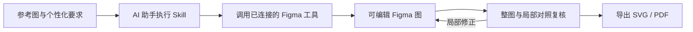
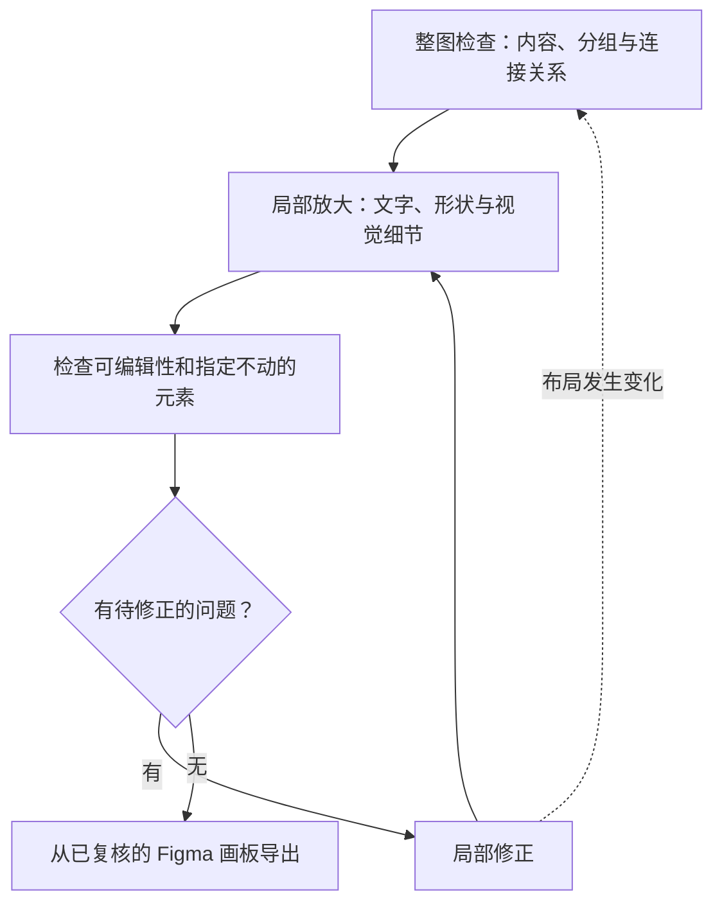

# Paper Figure to Figma

**高保真重建科研图，自由编辑每一步。**

**你需要的：** 一个支持看图、加载 Skill 和执行工具的 AI 助手，以及已授权写入的 Figma 连接。

**你得到的：** 高质量、可继续编辑的科研矢量图，支持 SVG 和 PDF 导出。

[English](README.md) · [Quick Start](#quick-start) · [工作流](#工作流) · [案例](#案例) · [TODO](#todo) · [Prompt 生成](https://sidiangongyuan.github.io/paper-figure-to-figma/)

[](examples/agentthink/reconstruction.svg)

AgentThink 复杂案例包含 **59 个可编辑文字层**、**264 个矢量路径节点**，无位图填充。[打开 SVG](examples/agentthink/reconstruction.svg) · [绘图文件](examples/agentthink/agentthink.scene.json) · [来源与还原说明](examples/agentthink/README.md)

**v0.1.0 · Preview**

## Quick Start

1. [下载 ZIP](https://github.com/sidiangongyuan/paper-figure-to-figma/archive/refs/heads/main.zip)，在支持 Skill 的 AI 助手中打开解压后的仓库。
2. 让助手读取 `.agents/skills/paper-figure-to-figma/SKILL.md`，或运行 `python tools/install_skill.py` 安装到 Codex 的个人 Skill 目录。
3. 在助手中授权连接 Figma，上传完整参考图，并附上目标 Figma Design 链接。

```text
使用 $paper-figure-to-figma，将附图重建到这个 Figma 画布，
检查整图与局部细节，修正后导出可编辑 SVG 和 PDF。
```

Skill 自行发现并调用 Figma 工具。助手需要支持图片输入、本地 Skill/脚本和外部工具调用。[安装与连接说明](docs/CODEX_QUICKSTART.md)

可用 [Prompt 页面](https://sidiangongyuan.github.io/paper-figure-to-figma/) 补充字体、配色和修改偏好。

## 工作流

提供完整参考图，以及字体、排版或局部修改要求。原始生图提示词和 VLM API 均非必需。



Skill 编排看图、图纸生成、原生图层绘制、对照复核和修订。Figma 连接提供实际写入权限。普通聊天窗口仅能输出内容时，需换用具备这些执行能力的助手。[使用说明](docs/CODEX_QUICKSTART.md)

### 整图与局部对照复核

以参考图、当前 Figma 导出结果和用户修改要求为依据，对同一位置进行相近尺度的比较。用户要求调整的字体或排版纳入目标效果。



| 检查层次 | 检查内容 | 输出 |
| --- | --- | --- |
| 整图 | 内容遗漏、分区布局、相对尺寸、分组及跨区箭头端点 | 定位结构差异 |
| 局部放大 | 文字准确性与完整显示、间距、曲线、渐变、底板、重复元素和遮挡顺序 | 标明区域、实际差异及修正方式 |
| 可编辑性 | 可编辑文字、独立矢量元素、合理分组及用户指定保持不变的内容 | 确认可继续修改，并保留受保护元素 |

优先修正内容与连接关系，再处理可读性和外观。每次修正后检查受影响区域及受保护元素；布局变化时重新检查整图。检查通过、近似处理和疑点已明确记录后结束复核。尚未确认的科学文字或连接含义仍标为待确认，不能仅凭节点数量认定还原完成。论文最终尺寸已知时，再检查实际使用尺寸下的可读性。

## 案例

### AgentThink

完整覆盖数据生成、两阶段训练、推理与评估。复杂小插画与品牌符号为矢量近似重绘，原图小卡片中部分占位文字无法辨清。


[参考图](examples/agentthink/reference.png) · [可编辑 SVG](examples/agentthink/reconstruction.svg) · [绘图文件](examples/agentthink/agentthink.scene.json) · [论文](https://arxiv.org/abs/2505.15298) · [样例说明](examples/agentthink/README.md)

### PlanWAM

[](examples/planwam/reconstruction.svg)

PlanWAM 样例包含 **43 个可编辑文字层**、**334 个矢量对象**和 **8 处渐变**。输入、输出 RGB 图像保留为独立图片层。[打开 SVG](examples/planwam/reconstruction.svg) · [绘图文件](examples/planwam/planwam.scene.json)

放大对照曲线、渐变和局部文字底板。重建版正文采用 Times New Roman，小车图标为矢量近似重绘。


[参考图](examples/planwam/reference.png) · [可编辑 SVG](examples/planwam/reconstruction.svg) · [绘图文件](examples/planwam/planwam.scene.json) · [样例说明](examples/planwam/README.md)

来源：[PlanWAM: Planning-Shaped Future Representations for End-to-End Autonomous Driving](https://arxiv.org/abs/2610.11382)，Figure 1。原始图片内容归其作者所有。论文中的可读性需按最终尺寸检查。

## Demo

下载后打开 **`demo/index.html`**。拖动分界线对照原图，修改文字、填色与曲线，下载编辑后的 SVG。支持离线使用。


这段 13 秒循环展示仓库附带的浏览器演示，开头与结束保留停顿。[操作说明](docs/SHOWCASE.md)

## TODO

已完成的能力与后续改进方向；未勾选项为待开发内容。

- [x] ~~Codex Skill 调用 Figma 完成绘制、复核和导出~~
- [x] ~~PlanWAM、AgentThink 可编辑案例及可视化对比~~
- [x] ~~Prompt 生成页面与慢速流程演示~~
- [ ] 按论文最终尺寸检查字号、线宽和间距。
- [ ] 完善局部更新，保护用户在 Figma 中的手动修改。
- [ ] 改善数学符号与公式的还原。
- [ ] 支持风格迁移，在保留内容与结构的基础上调整配色、字体和视觉样式。
- [ ] 兼容 PowerPoint、draw.io 等工具，支持可编辑格式的导入与导出。
- [ ] 扩充案例，并提供可复现的还原质量评估。
- [ ] 扩展不同 Skill 助手与操作系统的兼容性验证。

## 文档

[Quick Start](START_HERE.md) · [Demo 操作](docs/SHOWCASE.md) · [开发文档](docs/DEVELOPMENT.md)

工作流参考：[Image To Slice](https://github.com/50kg/image-to-slice)。

## 许可

项目代码采用 [MIT 许可](LICENSE)。参考图片、论文内容及据此重建的示例图保留原有权利和适用条款，来源见各案例说明。
