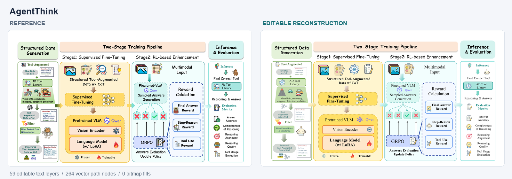
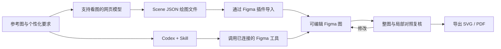
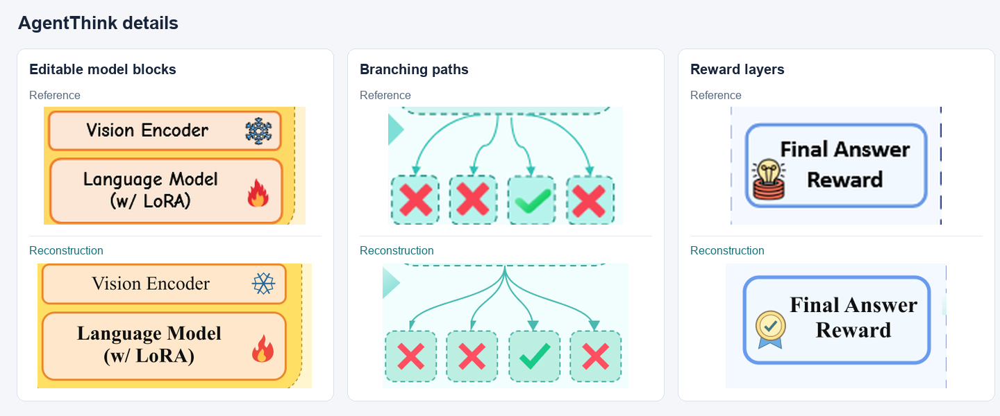
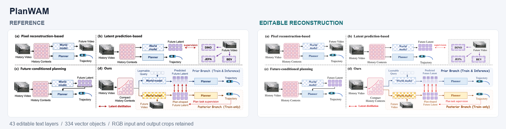
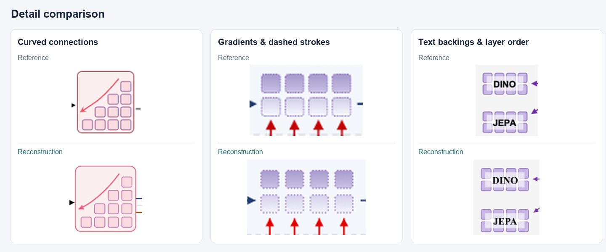

# Paper Figure to Figma

**高保真重建科研图，自由编辑每一步。**

**你需要的：** 一个支持看图并能输出绘图指令的 VLM，以及 Figma。

**你得到的：** 高质量、可继续编辑的科研矢量图，支持 SVG 和 PDF 导出。

[English](README.md) · [Quick Start](#quick-start) · [工作流](#工作流) · [案例](#案例) · [TODO](#todo) · [Prompt 生成](https://sidiangongyuan.github.io/paper-figure-to-figma/)

[](examples/agentthink/reconstruction.svg)

AgentThink 复杂案例包含 **59 个可编辑文字层**、**264 个矢量路径节点**，无位图填充。[打开 SVG](examples/agentthink/reconstruction.svg) · [绘图文件](examples/agentthink/agentthink.scene.json) · [来源与还原说明](examples/agentthink/README.md)

## Quick Start

[下载 ZIP](https://github.com/sidiangongyuan/paper-figure-to-figma/archive/refs/heads/main.zip) 并解压。插件和演示可直接使用。

### 网页模型 + Figma 插件

准备：Figma 桌面版，以及支持看图、输出文字或文件的网页模型账号。

1. 在 Figma Design 文件中打开 **Plugins → Development → Import plugin from manifest…**，选择 `figma-plugin/manifest.json`。
2. 运行 **Paper Figure to Figma (local)**，点击 **加载 PlanWAM 示例 → 生成到 Figma**，试用附带样例。
3. 制作自己的图：在插件中选择完整参考图，将图片和复制的绘图指令一起发给网页模型。
4. 导入模型返回的 `.json` 文件，对照修改后导出 SVG 或 PDF。

[安装与使用详情](docs/WEB_QUICKSTART.md)

### Codex

1. 在 Codex 中打开解压后的仓库文件夹，新建对话。
2. 上传完整参考图，发送：

```text
使用 $paper-figure-to-figma 复现这张整图，
完成 Figma 绘制、预览复核和导出。
```

Skill 自动调用已连接的 Figma 工具。首次使用按提示连接账号；修改已有文件时附上 Design 链接。

[Codex 安装与使用详情](docs/CODEX_QUICKSTART.md)

### Prompt

打开 [web/index.html](web/index.html)，选择模板并补充个性化要求。复制 Prompt，连同完整参考图发给 Codex。[使用与 GitHub Pages 部署](docs/PROMPT_PAGE.md)。

## 工作流

提供完整参考图，以及字体、排版或局部修改要求。原始生图提示词和 VLM API 均非必需。



模型理解图片并生成绘图指令。网页路径由用户传递文件，Codex 路径可通过已连接的工具直接写入 Figma。两种路径均保留可编辑文字和矢量元素，再对照原图检查布局、字体、渐变、曲线与图层顺序。论文使用前，按最终版面尺寸检查可读性。

[网页路径详情](docs/WEB_QUICKSTART.md) · [Codex 路径详情](docs/CODEX_QUICKSTART.md)

## 案例

### AgentThink

完整覆盖数据生成、两阶段训练、推理与评估。复杂小插画与品牌符号为矢量近似重绘，原图小卡片中部分占位文字无法辨清。



[参考图](examples/agentthink/reference.png) · [可编辑 SVG](examples/agentthink/reconstruction.svg) · [绘图文件](examples/agentthink/agentthink.scene.json) · [论文](https://arxiv.org/abs/2505.15298) · [样例说明](examples/agentthink/README.md)

### PlanWAM

[](examples/planwam/reconstruction.svg)

PlanWAM 样例包含 **43 个可编辑文字层**、**334 个矢量对象**和 **8 处渐变**。输入、输出 RGB 图像保留为独立图片层。[打开 SVG](examples/planwam/reconstruction.svg) · [绘图文件](examples/planwam/planwam.scene.json)

放大对照曲线、渐变和局部文字底板。重建版正文采用 Times New Roman，小车图标为矢量近似重绘。



[参考图](examples/planwam/reference.png) · [可编辑 SVG](examples/planwam/reconstruction.svg) · [绘图文件](examples/planwam/planwam.scene.json) · [样例说明](examples/planwam/README.md)

来源：[PlanWAM: Planning-Shaped Future Representations for End-to-End Autonomous Driving](https://arxiv.org/abs/2610.11382)，Figure 1。原始图片内容归其作者所有。论文中的可读性需按最终尺寸检查。

## Demo

下载后打开 **`demo/index.html`**。拖动分界线对照原图，修改文字、填色与曲线，下载编辑后的 SVG。支持离线使用。


这段 13 秒循环展示仓库附带的浏览器演示，开头与结束保留停顿。[操作说明](docs/SHOWCASE.md)

## TODO

已完成的能力与后续改进方向；未勾选项为待开发内容。

- [x] ~~网页模型绘图指令与本地 Figma 导入插件~~
- [x] ~~Codex Skill 调用 Figma 完成绘制、复核和导出~~
- [x] ~~PlanWAM、AgentThink 可编辑案例及可视化对比~~
- [x] ~~Prompt 生成页面与慢速流程演示~~
- [ ] 按论文最终尺寸检查字号、线宽和间距。
- [ ] 完善局部更新，保护用户在 Figma 中的手动修改。
- [ ] 改善数学符号与公式的还原。
- [ ] 支持风格迁移，在保留内容与结构的基础上调整配色、字体和视觉样式。
- [ ] 兼容 PowerPoint、draw.io 等工具，支持可编辑格式的导入与导出。
- [ ] 扩充案例，并提供可复现的还原质量评估。
- [ ] 完成 Figma 桌面端插件安装、导入和导出的端到端测试。

## 文档

[Quick Start](START_HERE.md) · [Demo 操作](docs/SHOWCASE.md) · [开发文档](docs/DEVELOPMENT.md)

工作流参考：[Image To Slice](https://github.com/50kg/image-to-slice)。

## 许可

项目代码采用 [MIT 许可](LICENSE)。参考图片、论文内容及据此重建的示例图保留原有权利和适用条款，来源见各案例说明。
