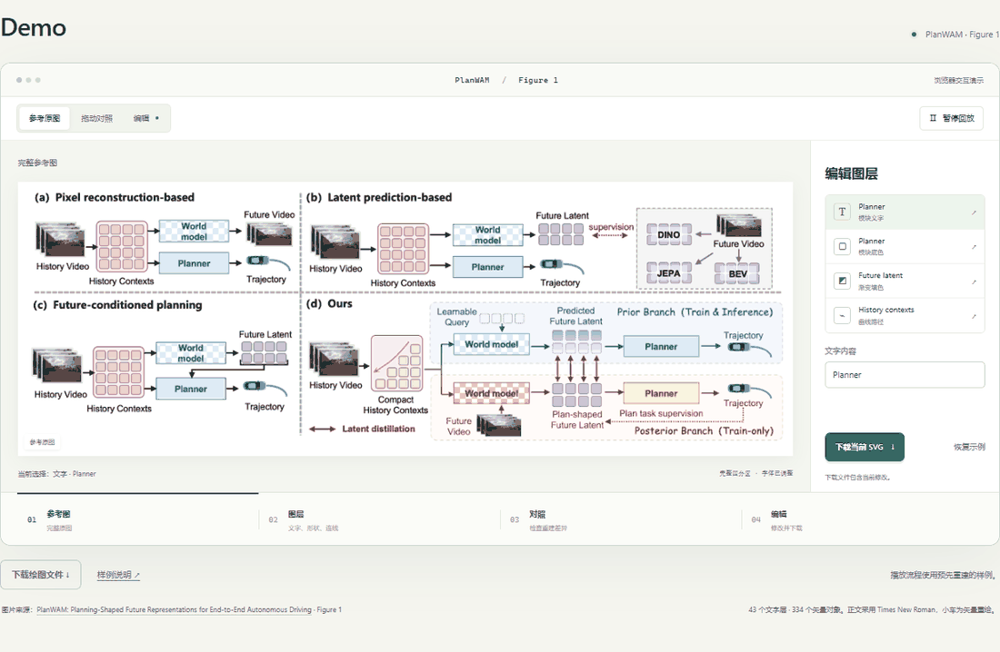
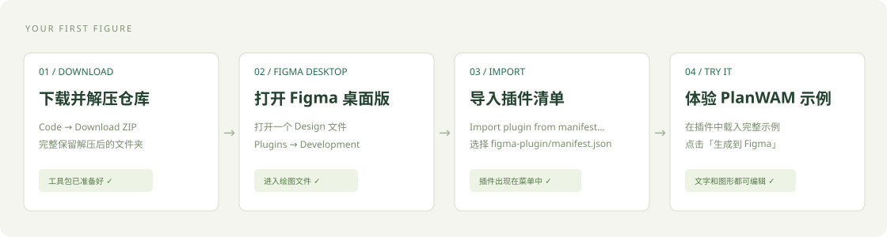

# 开始第一张图

**准备一张完整参考图、你常用的看图模型，以及 Figma。** 工具包已经附带插件、操作指令和 PlanWAM 完整样例。

## 先看效果

下载并解压仓库，双击 **`demo/index.html`**。

在演示中拖动分界线，对照原图与重建结果；点右侧图层，试着改文字、配色或曲线。点击「下载当前 SVG」可以保存刚改好的版本。演示支持离线打开。



## 选一种使用方式

### 使用网页模型



1. 在 GitHub 点击 **Code → Download ZIP**，解压后保留完整文件夹。
2. 在 Figma 桌面版打开一个 Design 文件。通过 **Plugins → Development → Import plugin from manifest…**，选择 `figma-plugin/manifest.json`，随后运行插件。
3. 点 **体验 PlanWAM 示例 → 生成到 Figma**，检查生成的文字与模块。
4. 开始自己的图：选择完整参考图，复制绘图指令发给模型；将返回的绘图文件导入插件，对照修改后导出。

[详细网页教程 →](docs/WEB_QUICKSTART.md)

### 使用 Codex

1. 在 Codex 中打开解压后的 **paper-figure-to-figma** 文件夹。
2. 上传完整参考图，发送：

```text
使用 $paper-figure-to-figma 复现这张整图，
完成 Figma 绘制、预览复核和导出。
```

Skill 会自行查找和调用可用的 Figma 工具。已有 Design 文件时附上链接；第一次按提示连接账号即可。

[详细 Codex 教程 →](docs/CODEX_QUICKSTART.md)

## 带走什么

Figma 可编辑图层、SVG、PDF、预览图片和下次可以继续使用的项目文件。正文默认 Times New Roman，编辑字号至少16px；论文排版后按最终尺寸检查可读性。

示例图片来源：**[PlanWAM: Planning-Shaped Future Representations for End-to-End Autonomous Driving](https://arxiv.org/abs/2610.11382)**，Figure 1。字体调整、矢量重绘等细节见 [样例说明](examples/planwam/README.md)。
