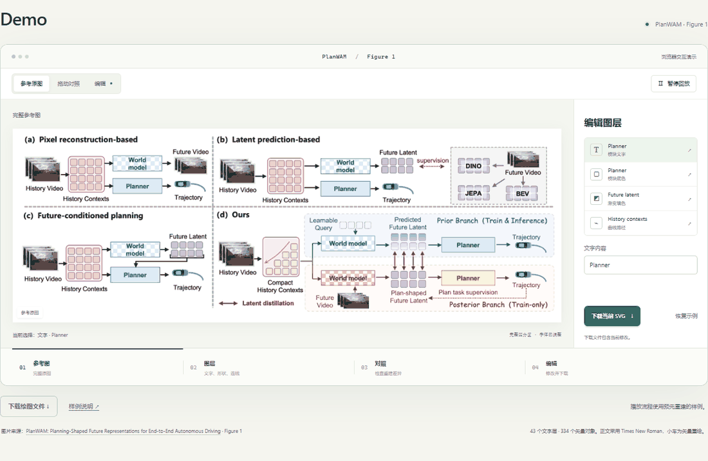

# Demo

下载并解压仓库，双击 **`demo/index.html`**。演示支持离线使用。

## 操作

1. 拖动分界线，对照原图与重建结果。
2. 选择 **Planner 文字**，输入模块名。
3. 选择模块底色或 **Future latent**，调整填色。
4. 选择 **History contexts**，拖动弧度滑块。
5. 下载 SVG 或绘图文件，保存修改。

播放按钮演示参考、图层、对照和编辑四个阶段，使用预先重建的样例。

在 Figma 中编辑：[插件安装](WEB_QUICKSTART.md) · [Codex 使用](CODEX_QUICKSTART.md)

## 示例

图片来源：**[PlanWAM: Planning-Shaped Future Representations for End-to-End Autonomous Driving](https://arxiv.org/abs/2610.11382)**，Xu et al., 2026，Figure 1。

[参考图](../examples/planwam/reference.png) · [可编辑 SVG](../examples/planwam/reconstruction.svg) · [绘图文件](../examples/planwam/planwam.scene.json) · [样例说明](../examples/planwam/README.md)
