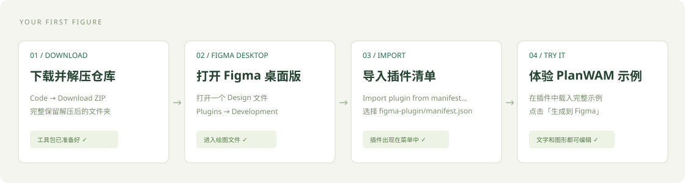
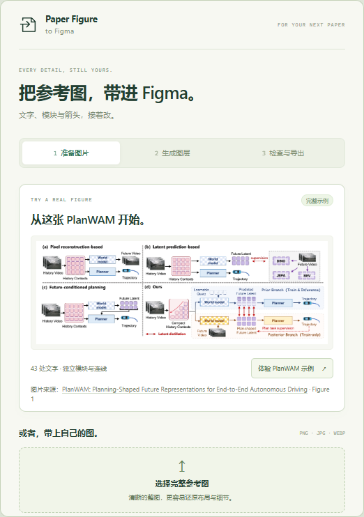

# 用网页模型，完成第一张可编辑科研图

准备：完整参考图、支持看图与文字/文件输出的网页模型账号、Figma 桌面版。原来的生图提示词可以省略。原始 RGB、输出结果图片或 SVG 图标有则一起带上。

## 1. 打开工具包

登录有仓库访问权限的 GitHub 账号，点击 **Code → Download ZIP** 并解压。完整保留文件夹，后面从这里打开插件。

想先看效果，双击 `demo/index.html`。这份交互演示支持离线打开。

## 2. 在 Figma 安装插件

1. 在 **Figma 桌面版** 打开一个可编辑的 **Design** 文件。
2. 打开菜单 **Plugins → Development → Import plugin from manifest…**，选择工具包里的 `figma-plugin/manifest.json`。
3. 在 **Plugins → Development** 运行 **Paper Figure to Figma (local)**。

当前提供本地开发插件；官方开发安装方式使用桌面版。[Figma 官方说明](https://developers.figma.com/docs/plugins/plugin-quickstart-guide/)。

如果 Figma 要求创建自己的插件标识

在 **Plugins → Development → New plugin → Figma design → Custom UI** 创建一个本地插件。把工具包 `figma-plugin/` 中的 `code.js` 和 `ui.html` 复制到新插件目录；保留 Figma 为你生成的清单及标识，确认清单中的 main/ui 分别指向这两个文件。这里使用的是已经准备好的文件，无需编译。

## 3. 先体验 PlanWAM

插件中点击 **体验 PlanWAM 示例**，再点 **生成到 Figma**。

完整四分区、43处文字和独立图形会进入画板。试着改一处 Planner 文字，选中一个模块或箭头，看看它们的编辑方式。

图片来源：**[PlanWAM: Planning-Shaped Future Representations for End-to-End Autonomous Driving](https://arxiv.org/abs/2610.11382)**，Figure 1。[样例文件和重建差异](../examples/planwam/README.md)。

## 4. 换成自己的图

**准备图片。** 插件第1步选择完整原图，点击 **复制绘图指令**。到你的网页模型中，上传同一张图片，粘贴并发送指令。模型会返回一个完整的绘图文件，或可复制的绘图内容。

**生成图层。** 到插件第2步选择模型返回的 `.json` 文件。模型只返回文字时，展开 **粘贴绘图内容**，放入完整内容并检查。需要换成数据集原图时，在素材区域选择对应图片。点击 **生成到 Figma**。

**检查与导出。** 到第3步下载对照预览、保存项目文件，连同原图和复核指令一起发回模型。把修订后的完整文件再次导入。对照通过后，下载 SVG 或 PDF，放进论文排版。

## 遇到问题时

- **绘图文件需要调整：** 复制复核指令，带上修复详情和原文件交给模型，打开修订后的完整文件再试。
- **图片位置对不上：** 确认选择的是同一张原始参考图；将尺寸与裁剪问题交给模型修正。
- **字体暂不可用：** 安装所需字体，或请模型替换为已安装字体。默认正文采用 Times New Roman。
- **复杂图写不完：** 优先让支持文件输出的模型提供一个完整绘图文件，也可以把已有文件交给 Codex 继续。

## 下次接着改

在第3步保存项目文件，下次重新打开即可。重新导入会更新同项目画板；手动改过的画板先复制一份，并明确选中需要更新的原画板。

项目文件记录模型与工具生成的绘图内容；Figma 后续的手动修改会出现在实际 SVG/PDF 导出里。正文编辑字号默认至少16px，排版后仍需按论文最终尺寸检查实际字号、线宽和可读性。
