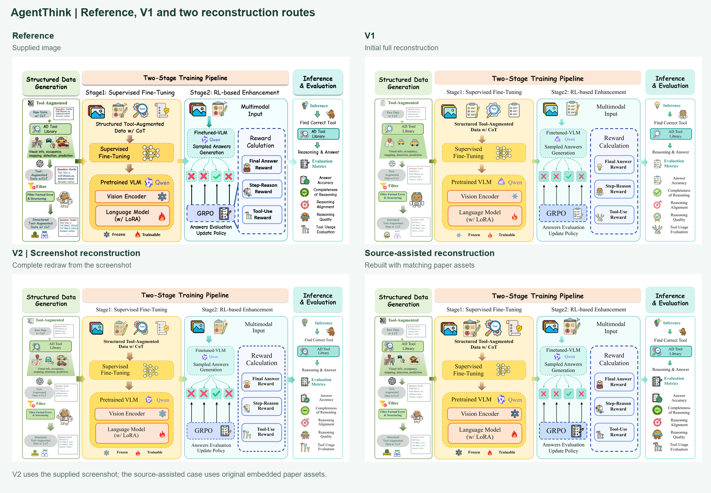
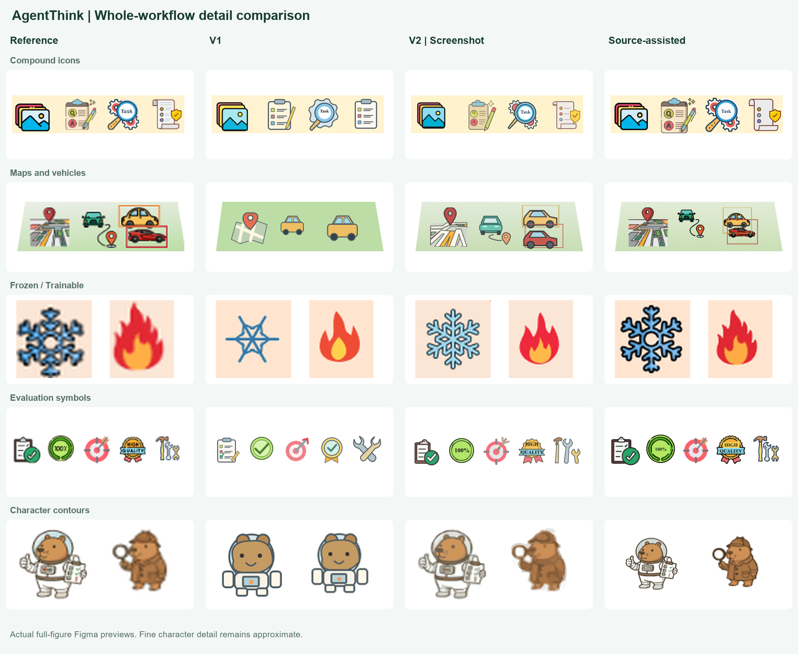
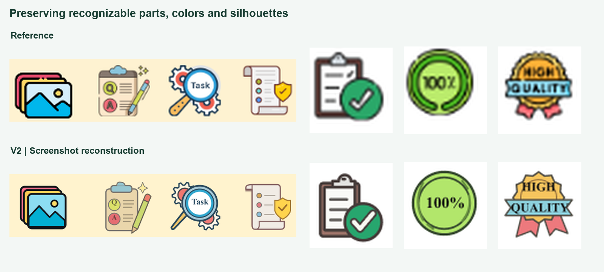

# AgentThink: V1, V2 and source-assisted reconstruction

The same [AgentThink framework figure](../agentthink/reference.png) reconstructed under two input conditions. The reference is from [AgentThink](https://arxiv.org/abs/2505.15298) and belongs to the paper's authors.

| | V1 | V2: screenshot | Source-assisted |
| --- | --- | --- | --- |
| Input | Supplied screenshot | Supplied screenshot | Matching original objects from the paper PDF |
| Scope | Initial full reconstruction | Complete redraw of all four panels | Existing layout retained; 36 icon instances rebuilt |
| Figma preview | [PNG](v1.png) | [PNG](v2.png) | [PNG](source-assisted.png) |
| Authored scene | [JSON](v1.scene.json) | [JSON](v2.scene.json) | [JSON](source-assisted.scene.json) |
| Native text layers | 59 | 72 | 64 |
| Bitmap fills in the reconstructed figure | 0 | 0 | 0 |

V1 is the preserved initial reconstruction used for this comparison. The earlier [AgentThink example](../agentthink/README.md) is a separate run. V2 is a complete new drawing, including all panels, text, icons, connections and local visual effects. The source-assisted result uses bitmap objects extracted from page 4 of the matching paper PDF, then vector reconstruction and native lettering; the extracted objects were not original SVGs.

## Details

- **Compound illustrations:** preserve identifiable parts, color and overlap—magnifier with gears, scroll with shield, clipboard with check overlay, numbered steps and quality banner.
- **Regular shapes:** construct geometry or repair a noisy trace instead of retaining ragged circles, lines and symbol edges. Lettering remains editable text.
- **Organic contours:** isolate and trace character shapes, reduce distracting fragments where appropriate, and compare the actual vectors at enlarged and normal scales.
- **Whole-figure coverage:** rebuild and review every region; a successful local sample does not stand in for a completed figure.
- **Visual effects:** retain gradients, dashed borders, curve branches and stacking while applying the default Times New Roman body typography.

## Inputs and review

The PNG results are actual native Figma previews exported at the same scale. Crops are laid out for comparison by `tools/build_v2_showcase.py`; they are not separate generated demonstrations. [asset-sources.json](asset-sources.json) records input conditions and provenance. Portable scenes retain native text plus vector geometry for future editing.

V2 was reconstructed from the supplied screenshot without consulting extracted paper assets during drawing. A matching bundled OpenAI vector supplies that brand mark; other illustrated objects use screenshot geometry or local tracing. The source-assisted route has access to additional original-image detail. These are qualitative workflow examples with different input conditions and drawing choices, not a controlled model benchmark or an accuracy percentage.

Whole-figure and enlarged-detail review covered content, relationships, icon appearance, text fit, gradients, curves and vector structure. Character faces and accessories remain approximate at low screenshot resolution. Tiny placeholder strings and decorative lettering are not exact facsimiles. Final paper-size readability depends on the intended physical dimensions.

## Attribution

Reference-derived artwork retains the original figure's rights. The OpenAI brand SVG is from Lobe Icons under its [MIT license](licenses/lobe-LICENSE); brand identifiers retain their respective rights. Project code licensing does not transfer ownership of paper figures or third-party artwork. No paper PDF or raw extraction archive is bundled with this example.
