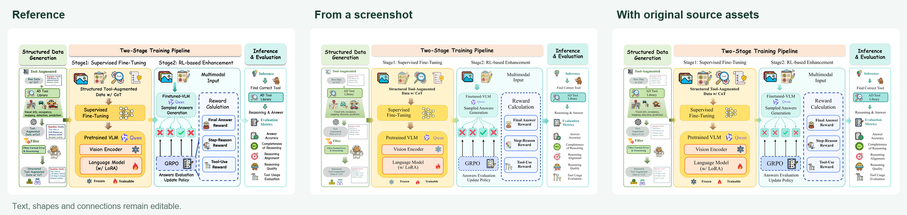
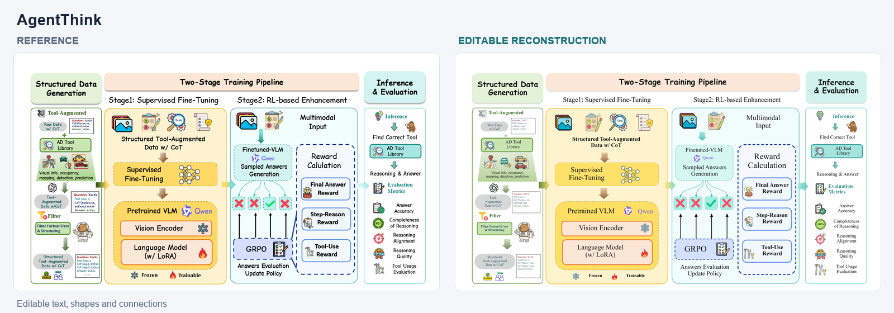
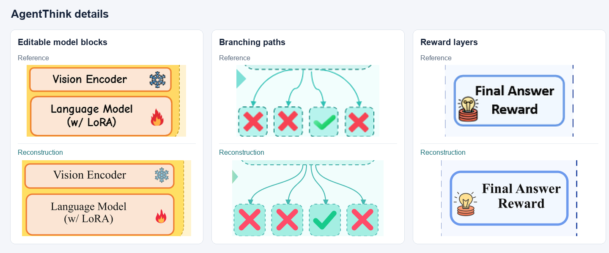

# AgentThink

Complete screenshot reconstruction of the framework figure from **[AgentThink: A Unified Framework for Tool-Augmented Chain-of-Thought Reasoning in Vision-Language Models for Autonomous Driving](https://arxiv.org/abs/2505.15298)**. [Official repository](https://github.com/curryqka/AgentThink).

[Reference](reference.png) · [Editable SVG](reconstruction.svg) · [Scene file](agentthink.scene.json) · [Figma export preview](preview.png)

Text, illustrations and connections remain separately editable in Figma. The preview shows the actual Figma result; the SVG is rendered from the matching authored scene.

The reconstruction covers all four panels, with editable text, compound illustrations, gradients, dashed borders and curved connections. Regular shapes are redrawn geometrically; character contours are traced and cleaned locally.

[Reconstruction using source assets](../agentthink-v2/source-assisted.png) · [Source-assisted scene](../agentthink-v2/source-assisted.scene.json)

[Version history comparison](../agentthink-v2/README.md) · [Asset provenance](../agentthink-v2/asset-sources.json)

Body text uses Times New Roman. Complex small illustrations and brand symbols are approximate vector redraws. Small source cards contain partly unreadable placeholder strings; these are not verified scientific text. Inspect the reference and reconstruction at the intended paper size. Pixel-level identity is not claimed.

Original figure content belongs to the paper's authors. This example demonstrates figure reconstruction rather than the authors' original editable artwork.
