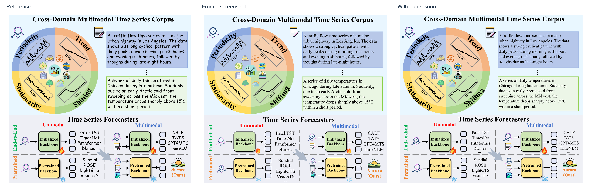
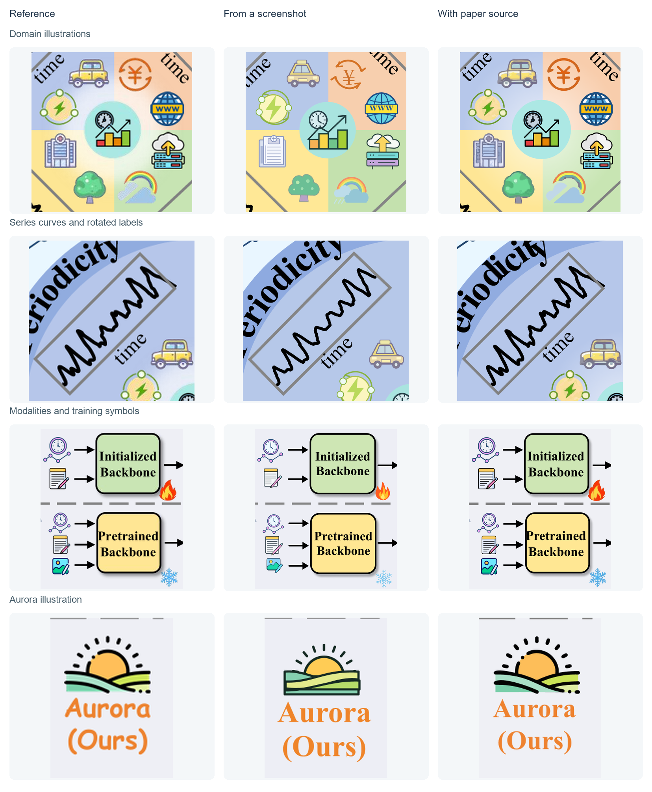
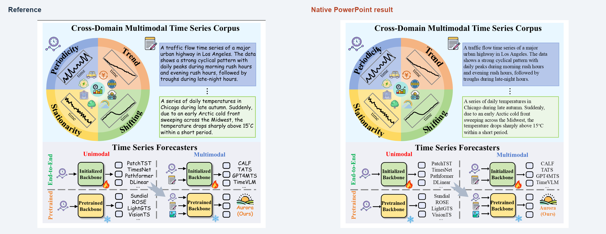

# Aurora · Figure 1

Two editable reconstructions of the same research figure: one made from a supplied screenshot, and one using the matching paper PDF. The screenshot reconstruction was completed before the paper was opened.

Source: **[Aurora: Towards Universal Generative Multimodal Time Series Forecasting](https://arxiv.org/abs/2509.22295)**, Xingjian Wu, Jianxin Jin, Wanghui Qiu, Peng Chen, Yang Shu, Bin Yang and Chenjuan Guo. **Figure 1, PDF page 2**, [arXiv version 6](https://arxiv.org/abs/2509.22295v6), revised March 9, 2026. [Authors' repository](https://github.com/decisionintelligence/Aurora) · [BibTeX](citation.bib)

[Reference screenshot](reference.png) · [Screenshot reconstruction preview](screenshot.png) · [Source-assisted preview](source-assisted.png) · [Source and reconstruction record](provenance.json)

## Reconstruction

| Input | Method | Editable result |
| --- | --- | --- |
| Screenshot only | Rebuild geometry and compound illustrations; recover the visible series strokes from the screenshot and clean their contours. | 61 text layers, 302 vector layers, no image layers |
| Matching paper PDF | Extract original vector curves and shapes, recover text, and vectorize the PDF's independently embedded icon images. Rebuild regular bitmap shapes as geometry. | 83 text layers, 688 vector layers, no image layers |

Both previews come from the actual reviewed Figma frames. Both use Times New Roman body text, replacing the reference's Comic Sans. The source-assisted route retains more of the original icon shapes and colors. These are visual reconstructions of plotted strokes, not recovered time-series datasets. Layer counts describe editability, not a fidelity score.

Figma frames: [Screenshot reconstruction](https://www.figma.com/design/znKenlNrxW7VLMcQQfEP6Q/?node-id=87-2) · [Source-assisted reconstruction](https://www.figma.com/design/znKenlNrxW7VLMcQQfEP6Q/?node-id=91-2). Figma access depends on the file's sharing permissions; the previews above are available directly in this repository.

## Details

The comparison covers the domain illustrations, series curves and rotated labels, modality and training symbols, and the Aurora illustration. Curved words use individually editable characters. Small lettering inside some source-derived icon paths remains outlined.

Several original PDF icons are only 55–75 pixels wide, so their fine contours remain approximate even with the paper source. The larger clock, document, web and server assets provide clearer evidence. Final paper-size readability must be checked at the intended physical dimensions.

## PowerPoint

[Download Aurora.pptx](Aurora.pptx) · [Clean PowerPoint preview](powerpoint.png) · [Selected objects](powerpoint-selected.png) · [Object counts](powerpoint.json)

The PowerPoint reconstruction uses the matching paper-source artwork: **83 native text boxes, 64 native shapes and paths, and 27 independent SVG objects**. Body text, curved-label characters, backbone boxes and series curves can be edited as PowerPoint objects. SVG illustrations can be moved, resized and replaced; their internal paths are not guaranteed to convert faithfully into native shapes.

The presentation was saved, reopened and rendered with desktop PowerPoint on Windows. The object-selection screenshot shows these objects selected in PowerPoint. The original paper attribution below applies to this example too.

## Citation and rights

Please cite the original paper when using its scientific content or adapting its figure:

> Wu, X., Jin, J., Qiu, W., Chen, P., Shu, Y., Yang, B., and Guo, C. *Aurora: Towards Universal Generative Multimodal Time Series Forecasting*. arXiv:2509.22295, 2025. DOI: [10.48550/arXiv.2509.22295](https://doi.org/10.48550/arXiv.2509.22295).

The reference figure and figure-derived artwork retain the original authors' rights and are not covered by this repository's MIT code license. These comparisons demonstrate reconstruction of the authors' figure; they are not author-supplied editable originals. The paper is distributed on arXiv under its [non-exclusive distribution license](https://arxiv.org/licenses/nonexclusive-distrib/1.0/).

Rebuild the comparison sheets with `python tools/build_aurora_showcase.py` from the repository root (requires Pillow).
