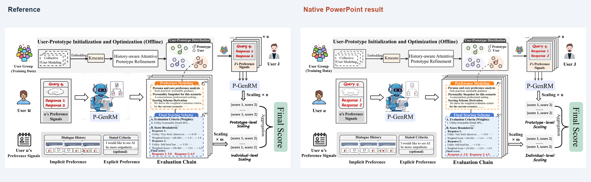
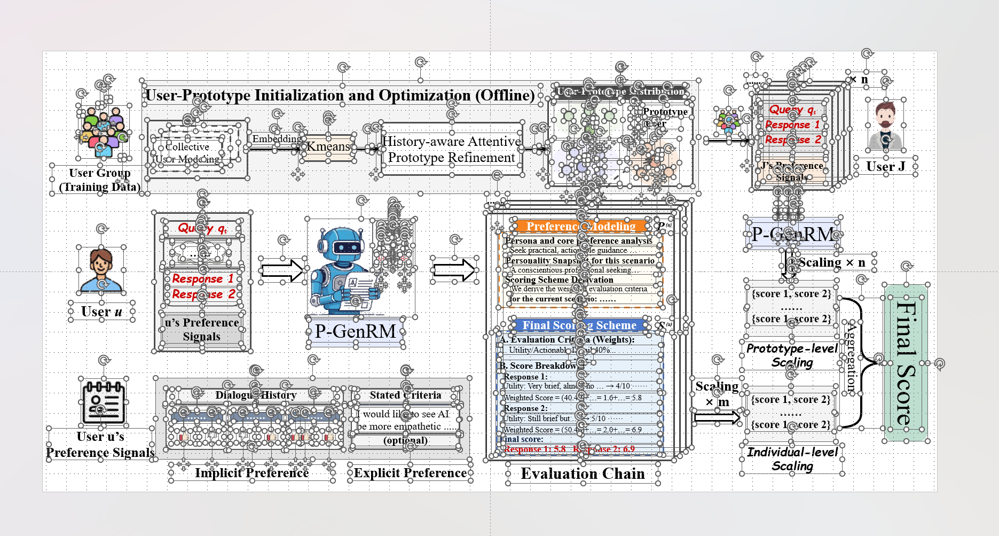

# P-GenRM · PowerPoint

**[Download the editable PPTX](P-GenRM.pptx)** · [PowerPoint preview](powerpoint.png) · [Selected objects](powerpoint-selected.png) · [Reference screenshot](reference.png) · [Scene](pgenrm.scene.json)

Reconstruction of the framework illustration from **[P-GenRM: Personalized Generative Reward Model with Test-time User-based Scaling](https://arxiv.org/abs/2602.12116)**, Pinyi Zhang et al., **ICLR 2026 Oral**. The arXiv record confirms the presentation status. [Conference proceedings](https://proceedings.iclr.cc/paper_files/paper/2026/hash/73bda9a20f6f9f6074ce822e76f126bb-Abstract-Conference.html) · [BibTeX](citation.bib)



## Editability

The slide contains **69 native text boxes**, **122 native shapes and paths**, and **13 independent SVG illustrations**. Text, subscripts, frames, arrows, dashed connections and the aggregation brace remain individually editable. Compound illustrations can be moved, resized and replaced as separate SVG objects; decomposing their internal paths is not guaranteed.



The selection screenshot was supplied by the user from PowerPoint. The clean preview is an actual PowerPoint slide export. The deck was saved, reopened and visually reviewed; a text-edit check confirmed that the tested text box retained its position, size and font size.

## Reconstruction conditions

This figure was reconstructed **only from the supplied screenshot**, without retrieving the paper or external icon assets. The paper attribution was supplied and checked afterward for publication. It did not inform or change the reconstruction.

Body text uses Times New Roman; selected query/response headings retain the reference's comic style. People and the robot are cleaned vector traces of screenshot crops. The robot's adjacent A+/B− document diagram was rebuilt with native text and shapes. The faint weighted-score expressions retain the visible screenshot characters; missing operators were not inferred. Original figure content and derived artwork retain their authors' rights and are not covered by the repository's MIT code license.

Rebuild in Windows with installed PowerPoint and pywin32:

```bash
python tools/ppt_native.py examples/pgenrm/pgenrm.scene.json local-outputs/pgenrm.pptx
```

The command creates the PPTX, a PowerPoint-rendered PNG and an execution report. Visual review is still required. Use a new output filename on each run. [PowerPoint workflow](../../prompts/05-powerpoint.md)

## Citation

The entry below follows the arXiv author list; the conference proceedings list differs.

> Pinyi Zhang et al. *P-GenRM: Personalized Generative Reward Model with Test-time User-based Scaling*. arXiv:2602.12116, 2026. [DOI](https://doi.org/10.48550/arXiv.2602.12116).
