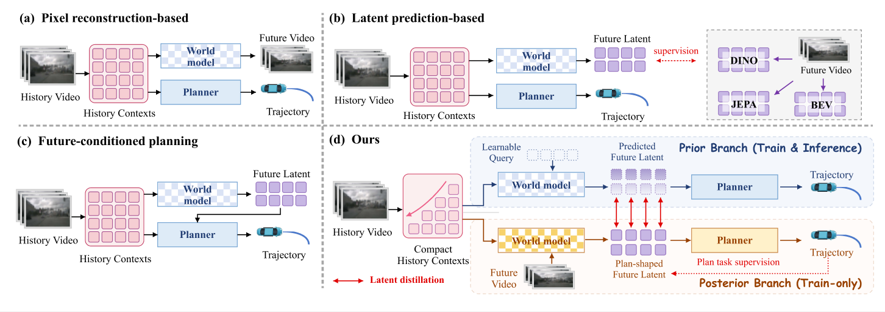

# PlanWAM · Figure 1

图片来源：**[PlanWAM: Planning-Shaped Future Representations for End-to-End Autonomous Driving](https://arxiv.org/abs/2610.11382)**，Jinchang Xu et al., 2026，Figure 1。

这是本项目已经完成并复核过的四分区重建样例。下载仓库后，可以在插件中直接体验，也可以用 Codex 打开绘图文件继续修改。

| 文件 | 用途 |
| --- | --- |
| `reference.png` | 本轮用户提供的完整参考图 |
| `reconstruction.svg` | 来自实际 Figma 画板的可编辑 SVG 导出，保留文字和矢量 |
| `planwam.scene.json` | 可导入插件、可交给 Codex 的完整绘图文件，包含所需 RGB 裁剪素材 |
| `showcase.json` | 从绘图文件统计的图层与字体信息 |

本示例含43个可编辑文字层、334个独立矢量对象和21个 RGB 图片层；RGB 来自2份图片素材，在多处重复使用。编辑画布为1452×513.33，文字字号至少16。

正文调整为 Times New Roman，分支标题保留漫画风字体；小车采用矢量重绘。输入与输出图片来自低分辨率参考图，正式排版优先使用原始数据集素材。整图和局部仍应与原图对照，最后按论文实际尺寸检查可读性。

网页演示可以调整标签、模块填色、渐变起始颜色和曲线路径；下载的 SVG 与绘图文件都会包含相应修改。浏览器演示使用本地交互，Figma 中的继续编辑通过随仓库提供的插件或已连接的 Codex 完成。

原始图像及论文内容的权利归其作者所有。这里的出处说明覆盖参考图与重建衍生内容，不为原始图像重新指定代码许可。作者页面：[PlanWAM project](https://jinchan9.github.io/PlanWAM_project_page/)。
